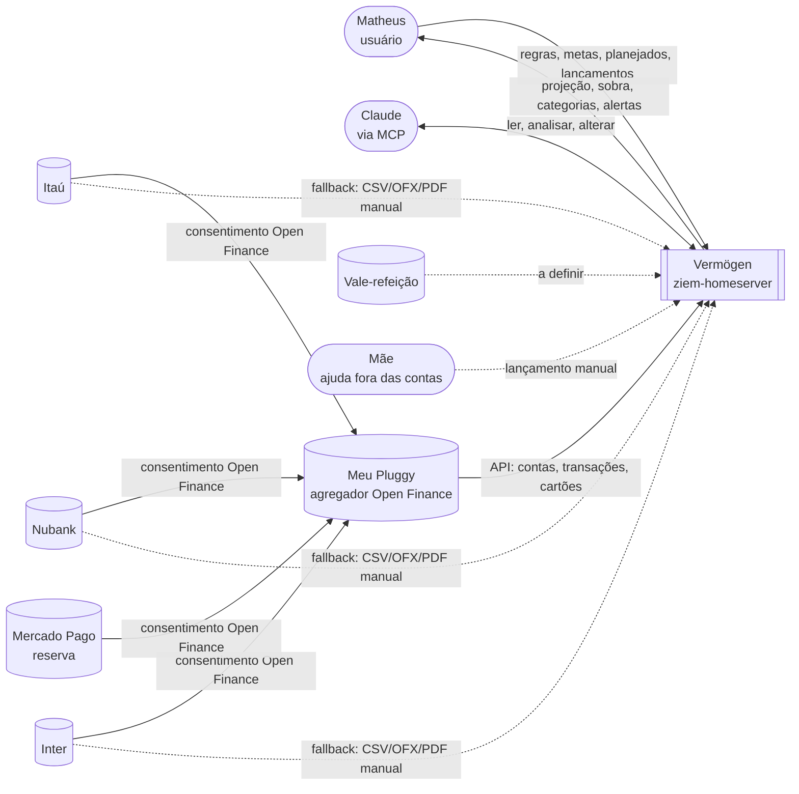
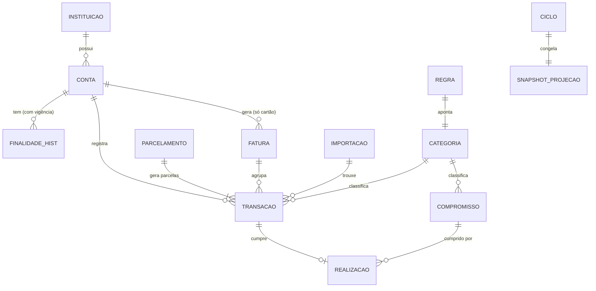
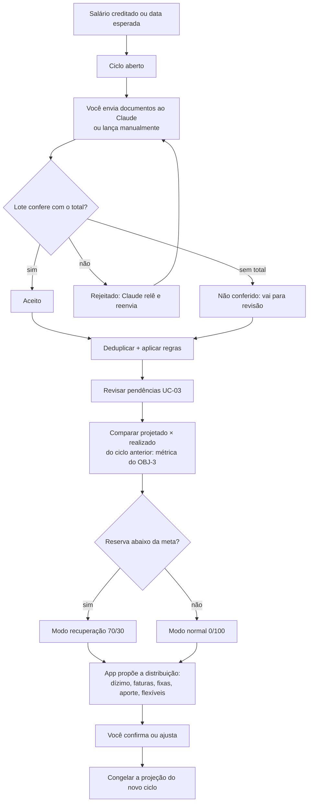
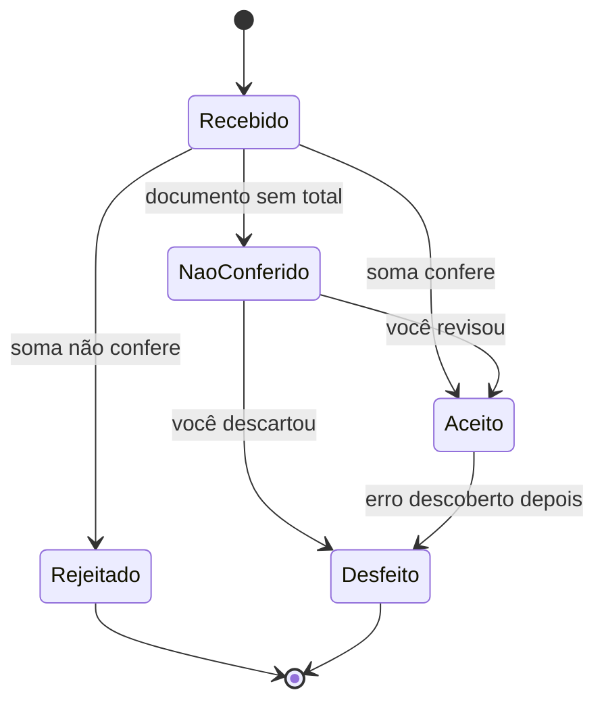
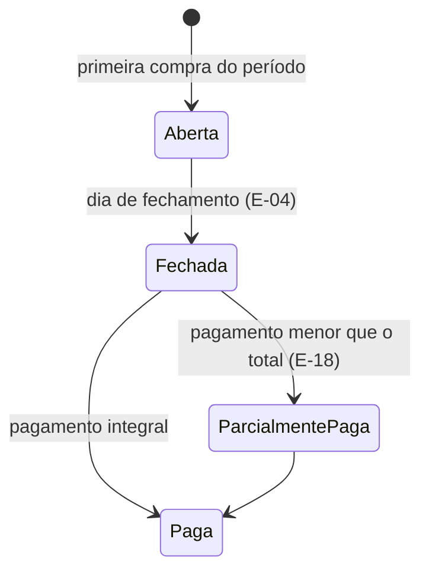
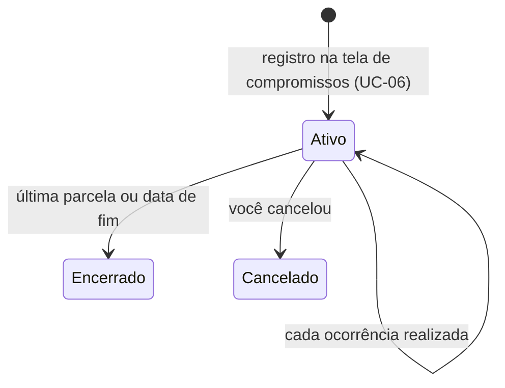

# PRD — Vermögen

> Plataforma financeira pessoal. Nome exibido: **Vermögen**; identificador técnico: `vermogen` (R7).

| Campo | Valor |
|---|---|
| Versão | **1.1** — sobre a baseline 1.0 (Práticas 1 a 20) |
| Status | **Baseline 1.0 aprovada em 02/11/2026.** Mudanças só pelo processo do §9.12. Fonte da verdade: repositório git (§9.12) |
| Autor / Dono | Matheus Ziem |
| Data | 24/10/2026 (criação) · 14/11/2026 (v1.1) |
| Método | *Software Requirements Essentials* (Wiegers & Hokanson, 2023), adaptado ao contexto doméstico |

> **Como este documento usa o livro.** O livro organiza o trabalho de requisitos em 20 práticas, agrupadas em 6 blocos: Fundamentos, Levantamento, Análise, Especificação, Validação e Gestão. Os §1 a §6 cobrem o bloco **Fundamentos** (Práticas 1 a 5):
>
> 1. Entender o problema antes de pensar na solução.
> 2. Definir os objetivos.
> 3. Definir as fronteiras da solução.
> 4. Identificar as partes interessadas.
> 5. Identificar quem decide.
>
> O §9 cobre Levantamento (Práticas 6 a 9), Análise (10 a 13), Especificação (14 a 17), Validação (18) e Gestão (19 e 20).
>
> A adaptação doméstica troca "objetivos de negócio" por **objetivos financeiros pessoais** e "stakeholders da empresa" pelas **pessoas e sistemas que influenciam o seu dinheiro**.

### Histórico

| Versão | Data | Mudança |
|---|---|---|
| 0.1 | 24/10/2026 | Base inicial |
| 0.2 | 24/10/2026 | Respostas às questões em aberto (Q1–Q8), viabilidade do Open Finance, acesso via MCP, hospedagem no homeserver, vale-refeição, mecanismo de planejamento dos gastos pontuais |
| 0.3 | 24/10/2026 | Open Finance decidido como acelerador opcional; permissões do MCP; regra do dízimo; vale-refeição Flash; capacidade do servidor medida; backup para o PC; prazos viram metas flexíveis |
| 0.4 | 24/10/2026 | Permissões do MCP confirmadas; composição do vale Flash; CPU do servidor medida; regra do saldo Premiação |
| 0.5 | 24/10/2026 | Casos de uso (Prática 6); regras do ciclo financeiro (RN-01 a RN-06); vale Flash por transação via CSV; rascunho de eventos e respostas (Prática 7) |
| 0.6 | 24/10/2026 | Datas de fechamento e vencimento dos 3 cartões (RN-08, RN-09); cartão do Mercado Pago; alerta de vencimento removido; horizonte de 12 ciclos confirmado; Prática 7 fechada |
| 0.7 | 24/10/2026 | Modelo de dados conceitual (Prática 8): entidades, relações, uso do pgcrypto, decisões D1–D5 |
| 0.8 | 01/11/2026 | Atributos de qualidade (Prática 9); MVP em Docker Compose e Kubernetes (k3s) adiado para fase posterior; orçamento de memória; decisões técnicas DT-01 a DT-03; UC-01 renomeado para "Procedimento de abertura do ciclo" |
| 0.9 | 02/11/2026 | Análise dos requisitos (Prática 10). **Mudança de canal de entrada:** o principal meio de ingestão passa a ser documentos enviados ao Claude, que lança via MCP; o MCP entra no MVP. Novas regras RN-10 a RN-13, entidade Orçamento, evento E-16 (resgate), dízimo só sobre o salário |
| 0.10 | 02/11/2026 | Banco e conta configuráveis (entidade Instituição; conta com tipo + finalidade com vigência, RN-14); distribuição do aporte com modo de recuperação da reserva (RN-15: 70/30 em recuperação, 0/100 no normal); meta de saldo da reserva atingida |
| 0.11 | 02/11/2026 | Modelos (Prática 11): fluxo do procedimento de abertura do ciclo e estados de lote, fatura e compromisso; achados M-01 a M-05; princípio de postura conservadora (§5); RN-10 passa a usar o maior valor dos últimos 3 ciclos; eventos E-17 e E-18 |
| 0.12 | 02/11/2026 | Protótipos de desktop (Prática 12, §9.8): regras de design, novos termos (resultado líquido, livre para gastar, líquido projetado, despesa projetada, veredito), "Posso comprar?" vira **Simulador de cenários** só de cálculo, folga mínima (RN-16), cor por instituição, Claude resolve pendências via MCP |
| 0.13 | 02/11/2026 | Protótipos responsivos para celular (DS-10); congelar a projeção com pendências é permitido, com sinalização (Q1 decidida); Prática 12 fechada |
| 0.14 | 02/11/2026 | Priorização (Prática 13, §9.9): MVP, Fase 2 e Fase 3; MCP e migração da planilha confirmados no MVP; cronograma do MVP |
| 1.0-rc | 02/11/2026 | **Mudança de papéis:** o desenvolvimento passa ao Claude e o Matheus fica como revisor; o aprendizado da stack vai para outro projeto (OBJ-L1 sai do escopo). Especificação do MVP (§9.10), validação (§9.11), baseline e gestão de mudanças (§9.12) |
| 1.0 | 02/11/2026 | Aprovado como baseline. Stack mantida (Q1). Revisão de coerência com os protótipos e com o Claude como desenvolvedor: protótipos mostram o produto completo (§9.8); HU-13, HU-16 e HU-17 ajustadas ao escopo do MVP; textos de aprendizado e de k3s atualizados |
| **1.1** | 14/11/2026 | **Nome do produto: Vermögen** (identificador técnico `vermogen`, R7). **Gestão de mudanças com vários chats** (§9.12): fonte da verdade passa a ser o repositório git; chat de Arquitetura e Desenvolvimento é o dono do PRD e do SAD; demais chats (ex.: DevOps) registram propostas. Arquitetura passa a ser registrada no SAD (§10). Impacto: nenhum em HU, prazo ou métricas |

---

## 1. Problema (Prática 1 — entender o problema antes da solução)

### 1.1 Situação atual

- O controle financeiro é feito "de cabeça". Há uma planilha e um painel montados à mão, mas eles estão sem atualização há ~2 meses: não existe rotina que os mantenha em dia.
- O dinheiro fica espalhado em **5 fontes**. A tabela mostra o uso **atual**; no app, o papel de cada banco e conta é configurável (§9.4, RN-14):

| Fonte | Uso atual |
|---|---|
| Itaú | Recebe o salário |
| Nubank | Cartão de crédito principal |
| Inter | Conta corrente, cartão e CDB |
| Mercado Pago | **Reserva de emergência** e cartão de crédito |
| Vale-refeição | Saldo de uso restrito a alimentação; não pode ser transferido entre contas |

- Quase todo pagamento passa pelo **cartão de crédito**. Isso faz o gasto de hoje sair do salário do mês seguinte.
- Há muitas despesas recorrentes (luz, internet, assinaturas, faculdade) e parcelamentos que se acumulam em paralelo.
- Existe receita irregular: a ajuda da mãe com a faculdade, que normalmente não entra na conta mental.

### 1.2 Declaração do problema

> **O problema de** não enxergar quanto da renda futura já está comprometida (fatura, parcelas e recorrentes)
> **afeta** o Matheus, que é quem decide quanto pode gastar e investir no mês,
> **cujo impacto é** usar a reserva de emergência para pagar contas ordinárias e não conseguir investir a meta de 10% do salário.
> **Uma solução bem-sucedida** mostraria, a qualquer momento, quanto sobra de fato no mês seguinte e para onde o dinheiro está indo.

### 1.3 Análise de causa raiz (5 porquês)

| # | Pergunta | Resposta |
|---|---|---|
| 1 | Por que estou usando a reserva? | Porque o saldo do mês não cobre as contas. |
| 2 | Por que não cobre? | Porque a fatura que chega é maior do que eu esperava. |
| 3 | Por que é maior do que eu esperava? | Porque somo de cabeça compras de vários cartões, mais parcelas antigas, mais recorrentes. E gastos grandes pontuais entram sem planejamento. |
| 4 | Por que somo de cabeça? | Porque os dados estão em 5 fontes, em formatos diferentes, e consolidar dá trabalho manual. |
| 5 | Por que isso leva a decisões ruins? | Porque eu decido o gasto pela **data da compra**, mas o dinheiro sai na **data da fatura**. Sem ver as duas datas, a "sobra" que eu enxergo é falsa. |

**Causa raiz:** a falta de uma visão de **caixa projetado**, isto é, de renda futura já comprometida, consolidada entre bancos.

### 1.4 Evidências

> ⚠️ **Os dados abaixo são de uma análise de 02/08/2026 e estão desatualizados há ~2 meses.** Eles servem para caracterizar o problema, não como baseline das métricas. A baseline real será recalculada na migração da base para o app.

| Indicador | Valor (jul/25–jul/26) | O que mostra |
|---|---|---|
| Sobra recorrente média | +R$295/mês antes da promoção; +R$448/mês depois | No recorrente, o mês **fecha positivo**. |
| Meses com sobra negativa | 4 de 13 | O problema é irregular, não constante. |
| Saídas grandes pontuais | R$18.590 no período | É **o que de fato corrói o caixa**, mais do que o gasto do dia a dia. |
| Aumento da promoção | +R$698/mês de salário | +R$544/mês foi absorvido por mais gasto recorrente. |
| Comprometimento com parcelas e faculdade | De R$2.325 (set/26) até R$0 (fev/27) | Mostra renda futura comprometida que hoje não se vê. |

> **Implicação para o produto:** o requisito central é um **projetor de caixa** que trata parcelas, fatura e gastos pontuais como itens de primeira classe. Categorizar entra como apoio.

---

## 2. Objetivos e métricas (Prática 2 — definir objetivos)

### 2.1 Objetivos financeiros pessoais

**OBJ-1 — Parar de usar a reserva para despesa ordinária**

| Métrica | Baseline | Meta | Prazo |
|---|---|---|---|
| Saques da reserva para despesa não emergencial | Houve saque recente (out/26) | 0 | De agora até **31/12/2026**, mantido depois |
| Saldo da reserva (Mercado Pago) | R$4.931 (24/10/2026) | ≥ R$5.000 | ✅ **Atingida** (informado em 02/11/2026). Daqui em diante, manter. Se cair abaixo, entra o modo de recuperação (RN-15) |

**OBJ-2 — Voltar a investir**

| Métrica | Baseline | Meta | Prazo |
|---|---|---|---|
| % do salário líquido aportado por mês | R$0 | ≥10% (≈R$460) | A partir de **jan/2027** |

**OBJ-3 — Saber quanto sobra no mês seguinte**

| Métrica | Baseline | Meta | Prazo |
|---|---|---|---|
| Diferença entre a sobra projetada no dia 1 e a realizada no fim do mês | Inexistente | Erro ≤ 10% | Primeira medição em **jan/2027**: projeção feita em 01/01, conferida em 31/01 |

**OBJ-4 — Ter clareza sobre para onde vai o dinheiro**

| Métrica | Baseline | Meta | Prazo |
|---|---|---|---|
| Gasto por categoria visível sem trabalho manual extra | Exige análise manual | Disponível a qualquer momento | MVP |

**OBJ-5 — Planejar os gastos grandes pontuais (acima de R$800, valor ajustável)**

| Métrica | Baseline | Meta | Prazo |
|---|---|---|---|
| % das saídas acima do limite que estavam planejadas antes de acontecer | 0% | ≥ 80% | **jan/2027** |

> **Natureza dos prazos (decisão do Matheus):** todos os prazos acima são **metas, não compromissos**. Se um não for atingido, ele se desloca para o mês seguinte, sem replanejar o produto.

> **Implicação de prazo:** o OBJ-3 exige o projetor de caixa **funcionando até o fim de dez/2026**, ou seja, em ~9 semanas. Os OBJ-1 e OBJ-2 **não dependem do app**: devem ser perseguidos em paralelo com a planilha atual. O app acelera esses dois, mas não é pré-requisito deles.

### 2.2 Objetivos técnicos

| ID | Objetivo | Métrica |
|---|---|---|
| ~~OBJ-L1~~ | ~~Aprender a stack~~ — **removido na v1.0-rc**: o aprendizado vai para outro projeto; o desenvolvimento deste é feito pelo Claude, com revisão do Matheus | — |
| OBJ-L2 | Hospedar e operar o serviço no próprio servidor caseiro (`ziem-homeserver`) | App em uso diário rodando no homeserver, acessível pela tailnet, seguindo as convenções do servidor (§6) |
| OBJ-L3 | Expor o app ao Claude via MCP | O Claude consegue ler, gerar análises e fazer alterações pelo MCP (§3.3) |

### 2.3 Restrição de realidade sobre o cartão

"Parar de depender do salário do mês que vem" **não** quer dizer parar de usar o cartão, porque por definição a fatura é paga com a renda seguinte. A meta operacional é esta:

> A fatura que vence no mês M, somada às despesas fixas de M, deve caber na renda de M **sem** tocar na reserva e **ainda** sobrando os 10% de investimento.

### 2.4 Como o produto apoia o OBJ-5 (planejar gastos pontuais)

A causa do problema é que um gasto grande só "existe" para você depois que acontece. O produto o faz existir **antes**, por quatro mecanismos:

| # | Mecanismo | Como funciona | Exemplo |
|---|---|---|---|
| 1 | **Gasto planejado** | Você registra valor, mês-alvo e forma de pagamento (à vista ou em N parcelas). O gasto entra na projeção como compromisso futuro, igual a uma parcela. | "Tênis, R$900, dez/26, 3x" → a projeção de dez, jan e fev já desconta R$300 |
| 2 | **Simulador de cenários** (antes "posso comprar?") | Antes de comprar, você informa valor e forma de pagamento. O app mostra o impacto no líquido projetado dos próximos ciclos e um veredito (Positivo / Moderado / Negativo), **sem gravar nada**. | "R$1.500 em 5x derruba a sobra de jan para R$-40 → furaria a meta de investimento" |
| 3 | **Provisão (caixinha)** | Para gastos grandes **previsíveis** (IPVA, presentes de fim de ano, rematrícula), o app calcula quanto separar por mês até a data. Esse valor sai da sobra mensal. | "IPVA R$1.200 em mar/27 → provisionar R$240/mês de out a fev" |
| 4 | **Detecção depois do fato** | Na importação, toda saída acima de R$800 que não está ligada a um gasto planejado é marcada como **"não planejada"** e pede uma justificativa. | Isso é o que torna o OBJ-5 mensurável: % planejado = vinculados ÷ total acima do limite |

Os mecanismos 1 a 3 previnem e o 4 mede. Sem o 4, o OBJ-5 não tem métrica.

### 2.5 Visão do produto

> **Para** o Matheus,
> **que** usa vários bancos e paga quase tudo no cartão, sem saber quanto da renda futura já está comprometida,
> **o** Vermögen
> **é um** projetor de caixa pessoal
> **que** consolida contas e cartões e mostra quanto sobra de fato nos próximos meses.
> **Diferente de** planilhas manuais e de apps de mercado que só categorizam o passado,
> **ela** trata fatura, parcelas e gastos pontuais como compromissos futuros, segue as regras dele (rateio da faculdade, transferências internas, dízimo, taxonomia própria) e pode ser consultada e operada pelo Claude via MCP.

---

## 3. Fronteiras da solução (Prática 3 — definir o que fica dentro e fora)

### 3.1 Diagrama de contexto

### 3.2 Viabilidade do Open Finance

**Conclusão: é viável, por um caminho específico e com riscos. Não pode ser o único meio de entrada de dados.**

| Caminho | Viável? | Motivo |
|---|---|---|
| Conectar direto no Open Finance Brasil | ❌ | Só participa instituição autorizada pelo Banco Central. Pessoa física não tem acesso direto. |
| Agregador comercial (Pluggy, Belvo, Tecnospeed) | ❌ | Custo relatado de R$540 a R$6.000/mês (mai/26), incompatível com uso pessoal. |
| **Meu Pluggy + conta de desenvolvedor Pluggy** | ✅ com riscos | Gratuito para dados das próprias contas. Você conecta os bancos no Meu Pluggy e o app lê pela API da Pluggy. Usado por projetos open source como o Actual Budget. |

**Cobertura (segundo a documentação da Pluggy):** Itaú, Nubank, Inter e Mercado Pago aparecem como conectores Open Finance. Os produtos de dados incluem contas, transações, cartões de crédito e investimentos. Vale-refeição não aparece na cobertura (a verificar).

**Riscos e como mitigá-los:**

| Risco | Mitigação |
|---|---|
| Os bancos só podem ser adicionados no Meu Pluggy **durante o trial** da conta de desenvolvedor. Depois disso, a lista de conexões fica travada. | Conectar **todos** os bancos de uma vez, no primeiro dia do trial. Fazer um spike (teste rápido) antes de começar. |
| Consentimento expira ou é revogado, e a conexão precisa ser refeita. | O app avisa quando a conexão estiver para expirar ou falhar. |
| É gratuidade não contratual: a Pluggy pode mudar a política. | Arquitetura com **porta de entrada abstrata**: o importador manual (CSV/OFX) continua existindo como alternativa. |
| A frequência de atualização varia por banco; a fatura do cartão pode vir incompleta. | Validar no spike se a fatura em aberto e as parcelas futuras vêm na API. Esse é o dado mais crítico para a projeção. |
| Um terceiro (Pluggy) acessa os seus dados bancários. | Aceitar conscientemente. A Pluggy é regulada no Open Finance. Guardar as credenciais da API criptografadas (pgcrypto). |

> **Decisão (v0.3):** o Open Finance é um **acelerador opcional, nunca uma dependência**.
>
> - O sistema precisa funcionar 100% só com importação manual (CSV/OFX/PDF) e lançamentos.
> - O adaptador Pluggy é uma fonte de dados entre outras. Se ele falhar, expirar ou deixar de ser gratuito, o app continua operando e apenas avisa que a sincronização parou.
> - Transações vindas do Open Finance e da importação manual passam pela **mesma deduplicação**, para que trocar de fonte, ou usar as duas, não duplique dados.
> - O adaptador entra **depois** de um spike que confirme fatura e parcelas.

### 3.3 Acesso pelo Claude via MCP

O app expõe um servidor MCP (Model Context Protocol) para o Claude ler dados, gerar análises e fazer alterações.

| Aspecto | Requisito candidato |
|---|---|
| **Ingestão (canal principal, v0.9)** | Você envia ao Claude os documentos que tiver (PDF, CSV, OFX, print de tela). O Claude extrai as transações e as envia ao app em **lote**, junto com o total que o documento declara. O app só aceita o lote se a soma bater ao centavo (QA-04) e se não for repetido (QA-05). |
| **Leitura** | Consultar transações, saldos, projeção, categorias, planejados e metas |
| **Análise** | Ferramentas de alto nível (ex.: "projeção dos próximos 3 meses", "gastos fora do padrão"). Sem expor SQL livre. |
| **Escrita** | O Claude **pode** alterar dados dentro do app (tabela abaixo) |
| **Proteção da escrita** | Toda alteração feita pelo Claude fica registrada (quem, quando, antes/depois) e pode ser desfeita. |

**Permissões de escrita do Claude (confirmadas na v0.4):**

| Pode | Condição | Não pode |
|---|---|---|
| **Importar lote de transações a partir de documento** | Validado pelo total declarado; registrado; o lote inteiro pode ser desfeito e reimportado | Alterar valor ou data de uma transação já registrada (o documento ou o banco é a fonte da verdade; erro de leitura se corrige desfazendo o lote) |
| Recategorizar transações; criar e ajustar regras de categorização | Registrado e reversível | |
| Registrar gasto planejado, provisão e lançamento manual | Registrado e reversível | Excluir definitivamente (qualquer registro) |
| Marcar duplicata e anotar transação | Registrado e reversível | |
| **Excluir** gastos, lançamentos, planejados e similares | **Exclusão lógica** (vai para uma "lixeira" e pode ser restaurada) | |
| **Resolver pendências** (UC-03): categorizar, confirmar ou excluir duplicata | Registrado e reversível | |
| **Registrar justificativa** de saída não planejada e **aceitar lote não conferido** | Registrado, reversível e **destacado no painel** até você revisar | |
| **Definir o motivo de um saque da reserva** | Registrado, reversível e **destacado no painel** até você revisar | |
| **Alterar metas e limites** (10%, R$5.000, R$800) | Registrado, reversível e **destacado no painel** até você revisar | |

> **Por que o destaque:** o motivo do saque da reserva, as metas e as justificativas são as métricas dos objetivos (OBJ-1, OBJ-2 e OBJ-5). Aceitar um lote não conferido é o Claude validando a própria leitura. A alteração continua permitida, mas fica visível para você, para que nenhuma métrica mude sem você perceber.

**Conectividade:** o homeserver **não expõe porta à internet** (decisão já tomada). Então o MCP é acessado pelo app do Claude no seu Windows, conectando ao homeserver pela tailnet (Tailscale). Consequência: o Claude só acessa o app quando o seu PC está ligado e com o app do Claude aberto. Como o MCP virou o canal principal de entrada, o **lançamento manual pela tela** é o plano B obrigatório.

### 3.4 Escopo

| Dentro (candidatos — a priorizar na Prática 13) | Fora (decidido) | Limitações conhecidas |
|---|---|---|
| **Ingestão por documentos enviados ao Claude** (PDF, CSV, OFX, print), lançados via MCP — canal principal | Conectar direto no Open Finance ou contratar agregador pago | Os bancos nem sempre permitem exportar OFX/CSV, e você nem sempre terá acesso ou tempo: o canal de entrada não pode depender de um formato |
| **Lançamento manual pela tela** — plano B obrigatório | | |
| Importar CSV/OFX pela própria tela, sem o Claude (fase posterior) | | |
| Sincronizar via Meu Pluggy (após spike) | Recomendar investimentos ou ativos | A gratuidade do Meu Pluggy não é contratual |
| Deduplicar as importações | Pagar contas ou fazer transferências | A ajuda da mãe não aparece nas contas: só por lançamento manual |
| Classificar com regras (categoria e tipo) | Vários usuários ou família | O MCP depende de o PC estar ligado |
| Detectar transferências internas | App nativo para celular | |
| Controlar parcelas (até quando cada uma vai) | Expor o app à internet pública | |
| Projetar o caixa dos próximos meses | Declaração de imposto de renda | |
| Planejar gastos pontuais: planejados, simulação, provisão e detecção (§2.4) | | |
| Orçamento por categoria e taxonomia própria (Intermitentes, Parceladas, Pontuais, Flexíveis) | | |
| Controlar a reserva: saldo, meta e saques com motivo | | |
| Vale-refeição como conta de uso restrito (§7) | | |
| Servidor MCP com ingestão, leitura, análise e escrita auditada (MVP) | | |
| Backup automático dos dados para o PC (fase 2, §6 R5) | | |
| Migrar a base atual (planilha) | | |

---

## 4. Partes interessadas (Prática 4 — identificar e caracterizar)

No contexto doméstico, "stakeholder" é qualquer pessoa ou sistema que **afeta ou é afetado** pelo dinheiro e pelo produto.

| Parte interessada | Papel | Interesse / influência | Implicação |
|---|---|---|---|
| **Matheus (usuário)** | Usuário principal | Quer clareza com pouco esforço mensal | Importação manual no máximo 1x/mês |
| **Matheus (revisor)** | Revisa entregas e opera o servidor | Quer entregas verificáveis e pouco retrabalho | Cada entrega precisa de critério de aceite claro (§9.10) e dos comandos de implantação prontos (R6) |
| **Matheus (PM)** | Prioriza | Quer entregar valor cedo | Arbitra escopo e aprova entregas (ver §5) |
| **Claude** | **Desenvolvedor** (v1.0-rc) e, via MCP, segundo usuário e **canal principal de entrada de dados** | Lê documentos, lança lotes, analisa e altera dados | Precisa de ferramentas próprias, permissões, validação de lote e trilha de auditoria |
| **Mãe** | Fonte de receita irregular (rateio da faculdade) | Não é usuária | Precisa de lançamento manual de "receita fora das contas" |
| **Igrejas (dízimo)** | Destino recorrente (10%) | Compromisso fixo para ele | Entra na projeção como despesa fixa percentual |
| **Bancos e cartões** | Sistemas externos (fonte original) | Definem formato e prazo dos dados | O Claude lê qualquer formato; o app recebe sempre o mesmo lote (§3.3) |
| **Pluggy / Meu Pluggy** | Sistema externo (agregador) | Pode mudar a política de gratuidade | Adaptador isolado, substituível |

---

## 5. Quem decide (Prática 5 — tomadores de decisão)

Todos os papéis humanos são a mesma pessoa. O risco, então, não é conflito entre pessoas: é **conflito entre objetivos**. Por isso a regra de decisão fica explícita:

| Tipo de decisão | Quem prevalece | Regra |
|---|---|---|
| O que entra no MVP | Usuário/PM | Só entra o que serve aos objetivos OBJ-1 a OBJ-5 |
| Como implementar | Claude (dev) propõe, Matheus aprova | Decisões de implementação são registradas como DT; o Matheus aprova na revisão |
| Decisões técnicas | Claude propõe, Matheus aprova | O Claude registra cada decisão como **DT** (decisão técnica), com explicação em linguagem simples. Toda DT pode ser revista. |
| Conflito de prazo | Usuário/PM | Funcionalidade pronta e simples vence a elegante e incompleta |
| Alteração de dados pelo Claude | Matheus | O Claude pode alterar, inclusive metas e motivo de saque da reserva. Toda alteração é auditável e reversível. As que mexem em métricas ficam destacadas até você revisar (§3.3). |
| Mudança de requisito depois da baseline | PM | Registrar o motivo no histórico (Práticas 19 e 20) |
| Dúvida que só o uso real responde | Postura conservadora | Seguir a proposta registrada, escolhendo a opção **mais conservadora**: estimativa pessimista na projeção e escopo menor no MVP. O ajuste fino acontece depois, com o app em uso. |

---

## 6. Premissas e restrições

**Premissas** (se alguma se mostrar falsa, revisar o PRD):

- P1. O Meu Pluggy cobre fatura e parcelas dos cartões. **Validar no spike.** Se a premissa for falsa, o app só perde automação, não funcionalidade (§3.2).
- P2. **Trabalho manual de importação é aceitável no máximo 1x por ciclo.** Mais do que isso tem de ser automático. Na prática, o trabalho manual é **juntar os documentos e enviá-los ao Claude**. Não se pode contar com nenhum formato específico (OFX, CSV) estar sempre disponível.
- P3. A taxonomia atual (Intermitentes, Parceladas, Pontuais, Flexíveis) e as categorias da planilha servem como ponto de partida.
- P4. A faculdade termina em dez/2026, se o último semestre for concluído. Se não, a projeção de 2027 muda em ~R$1.070/mês.

**Restrições:**

- R1. Stack: Node.js/TypeScript, NestJS, Vue, PostgreSQL + pgcrypto, Docker Compose. Mantida mesmo com o desenvolvimento passando ao Claude: é a stack do trabalho do Matheus, e revisar código nela apoia o aprendizado no outro projeto (Q1, confirmado na v1.0). **Kubernetes (k3s) vira opcional**: só entra se houver motivo além de aprendizado.
- R2. São dados financeiros e pessoais (CPF, descrições, credenciais da API): nada pode ser exposto sem autenticação, e campos sensíveis vão criptografados.
- R3. O gargalo deixa de ser o desenvolvimento e passa a ser o tempo do Matheus para **revisar entregas, decidir e implantar**. Há prazo efetivo no fim de dez/2026 por causa do OBJ-3.
- R6. **O Claude não executa comandos no homeserver** (decisão já tomada sobre o servidor). Cada implantação é feita pelo Matheus, com os comandos entregues prontos em bloco de código.
- R7. **Nome:** "Vermögen" só em textos exibidos ao usuário. Identificadores técnicos (repositório, pacotes npm, containers, banco, pasta no servidor, hostnames) usam `vermogen`, sem trema, porque vários desses sistemas não aceitam caracteres acentuados.
- R4. **Hospedagem no `ziem-homeserver`**, com as consequências abaixo:

| Característica do servidor | Consequência para o app |
|---|---|
| Notebook HP de 2012: **15 GiB de RAM (~14 GiB livres)** e 15 GiB de swap, **4 núcleos**, medido em 24/10/2026 | Suficiente para a stack inteira, inclusive com k3s no futuro. A CPU de 2012 é o gargalo provável (ex.: build de imagem e importação de arquivos grandes). Cada container tem limite de CPU e memória (orçamento no §9.5, QA-12). |
| Sem porta exposta à internet; acesso só pela tailnet | O app e o MCP ficam acessíveis só na tailnet (§3.3) |
| Disco único, sem backup no host | Ver R5 |
| Convenções do servidor | Pasta `/srv/<app>/` própria (`/srv/vermogen/`), compose próprio, imagem com versão fixa, healthcheck, registro em `/srv/REGISTRY.md` |
| Queda de energia exige religar fisicamente | App e MCP indisponíveis até alguém religar |

- R5. **Backup dos dados do app para o PC do Matheus.** É viável e simples, e fica para a **fase 2**: depois do MVP, mas **antes de aposentar a planilha**. Até lá, a planilha é o backup.

| Decisão | Escolha | Motivo |
|---|---|---|
| O que copiar | Dump diário do PostgreSQL (`pg_dump`) | Um arquivo só, restaurável |
| Quem inicia | **O PC puxa do servidor** (tarefa agendada no Windows, via tailnet) | O PC nem sempre está ligado; o servidor tentar enviar falharia |
| Onde guardar | Pasta no OneDrive | Ganha cópia fora de casa sem custo |
| Proteção | Dump **criptografado antes de sair do servidor** | No OneDrive, o arquivo fica em nuvem de terceiros. O pgcrypto protege colunas no banco, não o arquivo de dump. |
| Retenção | Últimos N dumps (ex.: 30) | O disco do PC também é finito |
| Agendamento | Na fase Compose: tarefa agendada (cron) no servidor. Depois da migração: **CronJob do Kubernetes** | CronJob só se o k3s for adotado (R1) |

---

## 7. Glossário inicial (antecipa a Prática 17)

| Termo | Definição |
|---|---|
| **Data da compra (competência)** | Quando o gasto aconteceu. Base para análise por categoria. |
| **Data de pagamento (caixa)** | Quando o dinheiro sai da conta (ex.: vencimento da fatura). Base para a projeção. |
| **Renda comprometida** | Soma de fatura em aberto, parcelas futuras, fixas, gastos planejados e provisões de um mês ainda não vivido. |
| **Ciclo (mês financeiro)** | Período entre dois salários. O ciclo "M" vai do último dia útil de M−1 até a véspera do último dia útil de M (RN-01). É a unidade padrão de projeção e análise; o mês do calendário fica disponível como filtro. |
| **Resultado líquido** (antes "sobra") | Receita do ciclo − dízimo − faturas − fixas − aporte. Só considera dinheiro livre; o saldo da Flash aparece à parte como **saldo restrito**. Nos ciclos futuros, chama-se **líquido projetado**. |
| **Livre para gastar** | Orçamento de flexíveis do ciclo − gasto flexível já feito no ciclo. É o número principal da tela inicial. |
| **Despesa projetada** | No simulador, quanto a simulação tira de cada ciclo. Somada ao líquido projetado, mostra o líquido que haveria sem a simulação. |
| **Folga mínima** | Valor mínimo de líquido projetado por ciclo para o veredito ser Positivo (RN-16). |
| **Veredito** | Classificação do simulador: **Positivo** (acima da folga mínima), **Moderado** (entre zero e a folga), **Negativo** (abaixo de zero). |
| **Intermitentes** | Contas recorrentes de valor variável (luz, internet, telefonia, seguros, assinaturas). |
| **Parceladas** | Compras divididas em N meses, com data de término. |
| **Pontuais** | Saídas não recorrentes acima de R$800 (limite ajustável). |
| **Gasto planejado** | Pontual registrado antes de acontecer, com valor, mês-alvo e forma de pagamento. |
| **Provisão** | Valor separado por mês para um gasto grande previsível com data conhecida. |
| **Flexíveis** | Gasto do dia a dia controlável (gasolina, barbeiro, restaurante, lazer). |
| **Transferência interna** | Movimento entre contas do próprio Matheus. Não é receita nem despesa. |
| **Receita fora das contas** | Valor que reduz um custo, mas não passa por banco (ex.: a metade da faculdade paga pela mãe). |
| **Reserva de emergência** | Saldo no Mercado Pago. Meta: R$5.000. Todo saque precisa de motivo; um saque para despesa ordinária conta como falha do OBJ-1. |
| **Conta de uso restrito** | Saldo que não pode ser transferido entre contas. Hoje: cartão **Flash** (Mastercard), ~R$1.000/mês em dois saldos: • **Refeição e Alimentação** (~R$665): só para alimentação. Na projeção, reduz o dinheiro necessário para comida. • **Premiação do Cartão** (~R$335): pode ser usado em qualquer compra **à vista** com o cartão (loja física ou online). Não pode ser transferido, pagar boleto ou ser parcelado. Fora do dízimo. Na projeção, reduz o dinheiro necessário para **gastos flexíveis**; não pode cobrir fixas, fatura ou parcelas. A Flash não aparece como participante do Open Finance. A entrada é por **importação do CSV que a Flash exporta**, com o detalhe de cada transação, feita no procedimento de abertura do ciclo (UC-01). Cada transação entra no ciclo da sua data (RN-05). |
| **Dízimo** | 10% do **salário mensal líquido da Akiyama creditado no Itaú**, e só sobre ele. Não incide sobre 13º, férias, bônus, vale-refeição ou ajuda da mãe. Entra na projeção como despesa fixa percentual. |

---

## 8. Questões em aberto

| # | Questão | Por que importa |
|---|---|---|
| — | Nenhuma questão em aberto. Q1 (manter a stack) decidida na v1.0: **manter**. | — |

**Pendências (dependem de ação sua, não de decisão):**

| # | Pendência | Bloqueia |
|---|---|---|
| PD-1 | Trocar o e-mail de envio do CSV da Flash para o pessoal | Importação da Flash sem depender da VPN da empresa |

---

## 9. Levantamento (Práticas 6 a 9)

### 9.1 Casos de uso (Prática 6 — o que o usuário precisa fazer com a solução)

| ID | Caso de uso | Ator | Quando | Serve a |
|---|---|---|---|---|
| UC-01 | **Procedimento de abertura do ciclo**, disparado quando o salário cai: (1) enviar ao Claude os extratos, faturas e o CSV da Flash do ciclo anterior (ou lançar manualmente), conferir os lotes e revisar as pendências (UC-03); (2) comparar o projetado com o realizado; (3) distribuir o salário entre dízimo, fixas, fatura, aporte de 10%, reposição da reserva e flexíveis | Matheus | 1x por ciclo | OBJ-3, OBJ-1, OBJ-2 |
| UC-02 | **Sincronizar via Open Finance** | Sistema | Diário (automático) | Importação manual no máximo 1x/mês (P2) |
| UC-03 | **Revisar pendências**: sem categoria, possíveis duplicatas, saídas acima de R$800 não planejadas. É a etapa (1) do UC-01 e também existe sozinho, para depois da sincronização automática. | Matheus / Claude | Após importar ou sincronizar | OBJ-4, OBJ-5 |
| UC-04 | **Ver projeção** dos próximos ciclos, com a sobra separada em livre e restrita | Matheus / Claude | Semanal | OBJ-3 |
| UC-05 | **Simulador de cenários**: calculadora de entrada ou saída, **sem gravar nada**, nas formas à vista, parcelado em N vezes (ex.: tênis em 5x), recorrente sem fim (ex.: TotalPass) ou recorrente com fim. Mostra veredito, 1º ciclo afetado (pelas datas reais de fechamento), menor líquido, custo total e comparação entre formas de pagamento. Registrar é feito no UC-06, em tela própria. | Matheus / Claude | Quando surgir | OBJ-5, OBJ-3 |
| UC-06 | **Registrar compromisso futuro** (tela de compromissos) nas mesmas formas do UC-05: entradas (13º, bônus, venda, ajuda da mãe) e saídas (planejados, provisões, assinaturas) | Matheus / Claude | Quando surgir | OBJ-5, OBJ-3 |
| UC-07 | **Movimentar a reserva**: saque ou reposição, com motivo | Matheus / Claude | Quando ocorrer | OBJ-1 |
| UC-08 | **Registrar aporte de investimento** | Matheus / Claude | Por ciclo | OBJ-2 |
| UC-09 | **Lançamento manual** (ajuda da mãe, gasto fora das contas) | Matheus / Claude | Quando ocorrer | OBJ-3 |
| UC-10 | **Analisar gastos** por categoria e por ciclo (ou mês do calendário, como filtro) | Matheus / Claude | Por ciclo | OBJ-4 |
| UC-11 | **Gerenciar regras de categorização, metas e limites** | Matheus / Claude | Raro | Todos |
| UC-12 | **Revisar alterações do Claude** (ver os destaques, desfazer, restaurar da lixeira) | Matheus | Após uso do MCP | Proteção da escrita via MCP (§3.3) |

**Corte sugerido para o MVP** (prazo do OBJ-3 em dez/26): UC-01, UC-03, UC-04, UC-09 e UC-10, mais o UC-11 só para regras de categorização. **Desde a v0.9, o MVP inclui o MCP com a ingestão de lotes e o UC-12**, porque o MCP passou a ser o canal principal de entrada. Logo depois entram os UC-05 a UC-08, que dependem da projeção. O UC-02 depende do spike do Meu Pluggy. *(Corte final: §9.9.)*

### 9.2 Regras do ciclo financeiro (antecipa a Prática 16 — regras de negócio)

| ID | Regra |
|---|---|
| RN-01 | **Ciclo:** o ciclo "M" vai do último dia útil de M−1 até a véspera do último dia útil de M. É calculado pelo calendário, não pelo crédito real. |
| RN-02 | **Dia útil:** segunda a sexta, menos os feriados bancários **nacionais**. O 31/12 não tem expediente bancário. |
| RN-03 | **Crédito do vale:** dia 25, ou o último dia útil anterior. |
| RN-04 | **Data real do salário:** você pode alterar a data em que o salário entrou num ciclo. A data informada substitui a da RN-01, e o app redistribui as transações entre os ciclos afetados. Se o salário não entrar na data esperada, o app avisa. |
| RN-05 | **Alocação do vale:** cada crédito e cada gasto do vale entram no ciclo da sua própria data. O saldo que sobra passa para o ciclo seguinte. |
| RN-06 | **Horizonte de projeção:** 12 ciclos. Recorrências sem fim são projetadas até esse limite. |
| RN-07 | **Dízimo:** 10% do salário mensal líquido da Akiyama creditado no Itaú, e só sobre ele. Não incide sobre 13º, férias, bônus, vale ou ajuda da mãe. |
| RN-08 | **Faturas:** cada cartão tem dia de fechamento e de vencimento configuráveis. O ciclo em que uma compra é paga é o ciclo que contém o **vencimento** da fatura em que ela entrou. O app usa as datas reais, nunca a aproximação "compra no ciclo M, paga no ciclo M+1" (ver exemplo abaixo). |
| RN-09 | **Datas inexistentes ou não úteis** *(premissa)*: fechamento num dia que o mês não tem (ex.: 31 em novembro) passa para o último dia do mês; vencimento em dia não útil passa para o próximo dia útil. |

**Cartões (RN-08):**

| Cartão | Fechamento | Vencimento | Ciclo em que é paga |
|---|---|---|---|
| Mercado Pago | Dia 29 do mês anterior | Dia 04 | Ciclo M (vence no início do ciclo) |
| Inter | Dia 31 do mês anterior | Dia 07 | Ciclo M |
| Nubank | Dia 01 | Dia 09 | Ciclo M |

> **Por que usar as datas reais:** os três vencimentos caem entre os dias 4 e 9, ou seja, todos são pagos com o salário que abriu o ciclo. Na maior parte do tempo vale "compra no ciclo M, paga no ciclo M+1", mas não nas bordas. Exemplo: o ciclo Novembro começa em 30/10. Uma compra no Nubank em 30/10 entra na fatura que fecha em 01/11 e vence em 09/11, e é paga **no mesmo ciclo** em que foi feita.

**Exemplo (2026):**

| Ciclo | Começa (salário) | Termina | Vale dentro do ciclo |
|---|---|---|---|
| Novembro | 30/10 (sex; 31/10 é sábado) | 29/11 | 25/11 (qua) |
| Dezembro | 30/11 (seg) | 29/12 | 24/12 (qui; 25/12 é Natal) |
| Janeiro/27 | 30/12 (qua; 31/12 sem expediente bancário) | — | — |

### 9.3 Eventos e respostas (Prática 7 — identificar eventos e respostas)

O livro separa três tipos de evento: **de negócio** (algo acontece fora do sistema), **temporal** (chega uma data) e **de sinal** (uma condição dos dados é atingida).

| ID | Evento | Tipo | Resposta do sistema |
|---|---|---|---|
| E-01 | Salário creditado | Negócio | Abre o ciclo, dispara o checklist do UC-01 e propõe a distribuição do salário |
| E-02 | Data esperada do salário passou sem crédito | Temporal | Alerta (RN-04); o ciclo não se desloca |
| E-03 | Vale creditado | Negócio | Atualiza o saldo restrito (sobra restrita) |
| E-04 | Fatura fechou (dia de fechamento de cada cartão, RN-08) | Temporal | O valor da fatura passa de estimado a fechado na projeção do ciclo de vencimento; mostra a diferença em relação ao estimado |
| ~~E-05~~ | ~~Fatura vence em N dias~~ | — | **Removido (v0.6):** o banco já avisa |
| E-06 | Importação ou sincronização concluída | Negócio | Deduplica, classifica pelas regras e gera as pendências do UC-03 |
| E-07 | Saída acima de R$800 sem gasto planejado vinculado | Sinal | Marca como "não planejada" e pede justificativa (métrica do OBJ-5) |
| E-08 | Saque da reserva detectado (inclui pagar a fatura do cartão Mercado Pago com dinheiro da reserva) | Sinal | Exige motivo. Se for despesa ordinária, registra a falha do OBJ-1 |
| E-09 | Última parcela paga ou compromisso encerrado | Sinal | Remove da projeção e mostra a folga que se abre |
| E-10 | Sobra livre projetada menor que o aporte de 10% | Sinal | Alerta no início do ciclo (risco ao OBJ-2) |
| E-11 | Saldo da reserva abaixo da meta (R$5.000) | Sinal | Sugere reposição na distribuição do UC-01 |
| E-12 | Consentimento do Open Finance expirando ou sincronização falhando | Temporal / Sinal | Alerta; o app segue funcionando por importação manual |
| E-13 | O Claude alterou meta, limite ou motivo de saque da reserva, registrou justificativa ou aceitou lote não conferido | Sinal | Destaque no painel até você revisar (UC-12) |
| E-14 | Fim do ciclo (véspera do próximo salário) | Temporal | Fecha o realizado contra o projetado (métrica do OBJ-3). Compara o aporte proposto com o realizado; abaixo do proposto conta como falha do OBJ-2 (M-04) |
| E-15 | Backup sem sucesso há N dias (fase 2) | Sinal | Alerta |
| E-16 | Resgate de investimento detectado | Sinal | Exige motivo, como o saque da reserva (RN-12) |
| E-17 | Ciclo aberto há mais de 3 dias sem o procedimento de abertura | Temporal | Alerta. A projeção congelada guarda a data real em que foi feita (M-03) |
| E-18 | Fatura paga parcialmente | Sinal | **MVP:** alerta e marca a fatura como parcialmente paga. **Fase posterior:** projetar o saldo restante e os juros (M-02) |

### 9.4 Dados e relações (Prática 8 — avaliar conceitos de dados e relações)

**Entidades**

| Entidade | O que guarda | Atributos-chave |
|---|---|---|
| **Instituição** | Um banco ou emissor (Itaú, Nubank, Inter, Mercado Pago, Flash…) | nome, **cor** (identifica a instituição na lateral das linhas; configurável), ativo/inativo. Cadastrada e editada no app; tem **N contas**. Não carrega regra nenhuma: o comportamento vem das contas |
| **Conta** | Qualquer lugar onde há dinheiro ou dívida, dentro de uma instituição | nome, instituição, **tipo** e **finalidade** (abaixo), restrição de uso (só uso restrito). Cartões têm também dia de fechamento e de vencimento (RN-08). Tudo cadastrado e editável no app |
| **Finalidade da conta (histórico)** | Para que a conta é usada, com vigência | conta, finalidade, vigente de / até (RN-14) |

**Tipo × finalidade da conta**

| Característica | O que define | Valores | Pode mudar? |
|---|---|---|---|
| **Tipo** | O comportamento técnico do produto | `corrente` (saldo e extrato), `cartao` (fatura, fechamento, vencimento, parcelas), `investimento` (saldo aplicado), `uso_restrito` (saldo que só serve para certas compras) | Raramente. É o produto em si: um cartão não vira conta corrente |
| **Finalidade** | O papel no seu planejamento | `gasto`, `recebimento`, `reserva`, `investimento` (lista ampliável) | **Sim, a qualquer momento, com vigência** (RN-14) |

**Configuração inicial (exemplo; tudo editável):**

| Instituição | Conta | Tipo | Finalidade |
|---|---|---|---|
| Itaú | Conta corrente | `corrente` | `recebimento` |
| Nubank | Cartão | `cartao` | `gasto` |
| Inter | Conta corrente | `corrente` | `gasto` |
| Inter | Cartão | `cartao` | `gasto` |
| Inter | CDB | `investimento` | `investimento` |
| Mercado Pago | Reserva | `investimento` | `reserva` |
| Mercado Pago | Cartão | `cartao` | `gasto` |
| Flash | Alimentação | `uso_restrito` | `gasto` |
| Flash | Premiação | `uso_restrito` | `gasto` |
| **Fatura** | Uma fatura de cartão | conta, data de fechamento, data de vencimento, valor, valor pago, status (`aberta` / `fechada` / `paga` / `parcialmente_paga`) |
| **Transação** | Todo movimento realizado | conta, **data da compra**, **data do pagamento**, valor (`numeric(12,2)`, positivo = entrada), descrição original do banco, descrição editável, tipo, categoria, fatura, parcela (n/N), origem (`csv` / `open_finance` / `manual` / `claude`), id da importação, chave de deduplicação, motivo do saque (só reserva), justificativa (só não planejada acima de R$800), `deleted_at` (exclusão lógica) |
| **Parcelamento** | A compra "mãe" de um parcelado | valor total, N parcelas, data da compra. Gera as N transações-parcela. |
| **Compromisso** | Tudo que é futuro: planejados, assinaturas, entradas previstas (UC-05, UC-06) | direção (entrada ou saída), forma (`a_vista`, `parcelado`, `recorrente_sem_fim`, `recorrente_com_fim`, `provisao`), valor, início, fim, conta prevista, status (`ativo` / `encerrado` / `cancelado`). Mudança de valor cria nova vigência, sem alterar ocorrências passadas (M-05) |
| **Realização** | Liga um compromisso à transação que o cumpriu | compromisso, transação. Evita contar duas vezes (o projetado e o realizado) e mede o OBJ-5. |
| **Ciclo** | Um mês financeiro | id (`2026-11`), início, fim, data esperada do salário, data real (RN-04) |
| **Snapshot de projeção** | A projeção "congelada" no dia em que o ciclo abre (E-01) | ciclo, sobra livre e sobra restrita projetadas, detalhe em `jsonb`. É o que permite medir o OBJ-3, porque a projeção muda a cada importação. |
| **Categoria** | Árvore de categoria e subcategoria | nome, categoria-pai, natureza (Intermitente, Parcelada, Pontual, Flexível) |
| **Regra de categorização** | Classificação automática | padrão do texto, conta, faixa de valor → categoria e tipo, prioridade |
| **Meta** | 10% de aporte, R$5.000 de reserva, R$800 de limite | tipo, valor, vigência. É versionada: mudar uma meta cria uma nova versão. |
| **Distribuição do aporte** | Para onde vai o aporte de cada ciclo (RN-15) | modo (`recuperacao` / `normal`), lista de destinos (conta + percentual, somando 100%), vigência. Versionada como a Meta |
| **Importação (lote)** | Cada documento lançado pelo Claude, sincronização ou lançamento manual em bloco | fonte (`claude` / `open_finance` / `manual`), conta, período, hash do documento, **total declarado no documento**, contagens (novas, duplicadas, pendentes), status (`aceito` / `rejeitado` / `desfeito`) |
| **Orçamento** | Quanto se pretende gastar por categoria em cada ciclo (A-01) | categoria, valor por ciclo, vigência. Ponto de partida: R$1.420 de flexíveis, da planilha |
| **Conexão Open Finance** | Vínculo com a Pluggy | item id, status do consentimento, data de expiração, credenciais |
| **Feriado** | Para a RN-02 (dias úteis) | data, nome (só nacionais) |
| **Log de auditoria** | Toda alteração | quem (`matheus` / `claude` / `sistema`), entidade, antes e depois (`jsonb`), revisado (sim/não, alimenta o destaque), revertido por |

**Relações principais**

O ciclo da transação não é guardado: ele é **calculado** a partir da data do pagamento. Assim, uma alteração pela RN-04 (data real do salário) redistribui tudo sem migrar dados.

**Uso do pgcrypto**

| Dado | Decisão | Motivo |
|---|---|---|
| Senha de login, token do MCP | `crypt()` + `gen_salt('bf')` (hash) | Nunca precisam ser lidos de volta |
| Credenciais da Pluggy | `pgp_sym_encrypt` | Segredo que precisa ser lido de volta |
| Anotações e justificativas livres | `pgp_sym_encrypt` | Texto pessoal, nunca agregado |
| Valores e datas | Sem criptografia | Somar, agrupar e filtrar no banco é o núcleo do app |
| Descrições das transações | Sem criptografia (D4) | As regras e a busca precisam ler o texto |

A chave de criptografia nunca fica no banco nem no código. Na fase Compose, ela entra por um arquivo de segredo no servidor, fora do repositório e com acesso restrito. No k3s, entra por um Secret, que por padrão é só codificado em base64 e por isso precisa de criptografia em repouso (QA-03).

**Decisões (confirmadas na v0.7)**

| # | Decisão |
|---|---|
| D1 | **Parcelado aparece de dois jeitos, guardado uma vez só.** O parcelamento mostra o valor cheio na visão por data da compra; as parcelas mostram o valor de cada mês na visão de caixa e na projeção. |
| D2 | **Transações idênticas viram "possível duplicata" para revisar, nunca são descartadas automaticamente.** Caso real na base: os dois dízimos no mesmo dia para igrejas diferentes. Pelo Open Finance, a deduplicação usa o id externo. |
| D3 | **A faculdade 50/50 não reduz o valor da transação.** A transação fica com 100%, e a metade da mãe entra como receita fora das contas, vinculada a ela. **Na migração da planilha, as 12 linhas de mensalidade reduzidas a 50% precisam voltar a 100%** e ganhar o lançamento correspondente. |
| D4 | **As descrições não são criptografadas.** O acesso já é restrito à tailnet e a um único usuário. Se for preciso proteger mais, a alternativa é separar o CPF num campo próprio criptografado. |
| D5 | **A projeção é congelada (snapshot) a cada abertura de ciclo.** |

### 9.5 Atributos de qualidade (Prática 9 — levantar e avaliar atributos de qualidade)

Cada atributo é mensurável e tem uma forma de verificação.

| ID | Atributo | Requisito | Como verificar | Prioridade |
|---|---|---|---|---|
| QA-01 | Segurança | Nenhuma porta publicada fora de `127.0.0.1` ou do IP da tailnet | Scan a partir da LAN não encontra porta aberta | Alta |
| QA-02 | Segurança | Login obrigatório no app web, com sessão de 30 dias por dispositivo; o MCP usa token próprio, revogável | Acesso sem credencial retorna 401 | Alta |
| QA-03 | Segurança | Chave do pgcrypto e credenciais nunca no repositório nem na imagem. No k3s, Secrets criptografados em repouso (`--secrets-encryption`) | Varredura do repositório e da imagem não encontra segredo | Alta |
| QA-04 | Integridade | Um lote só é aceito se a soma das transações bater exatamente com o total declarado no documento (diferença R$0,00). Esta é a proteção contra erro de leitura do Claude. Se o documento não trouxer total, a conferência usa saldo inicial + movimentos = saldo final. Se não houver nenhum dos dois (ex.: print parcial), o lote entra como **"não conferido"** e vai para revisão no UC-03 | Lote com diferença é rejeitado | **Alta** |
| QA-05 | Integridade | Importar o mesmo arquivo duas vezes gera 0 transações novas | Teste automatizado | **Alta** |
| QA-06 | Integridade | 100% das alterações (suas, do Claude e do sistema) ficam no log e podem ser revertidas | Teste por tipo de alteração | Alta |
| QA-07 | Correção | As regras de ciclo e fatura (RN-01 a RN-09) têm testes automatizados para os casos de borda: 30/10, 31/12, 25/12, fechamento no dia 31 em mês de 30 dias | Testes passando no build | **Alta** |
| QA-08 | Recuperação | Depois de religar o servidor, tudo sobe sozinho, sem intervenção, em até 10 min | Teste de reboot | Alta |
| QA-09 | Recuperação (fase 2) | Perda máxima de 24 h de dados; restauração testada ao menos 1x antes de aposentar a planilha | Restauração do dump num ambiente limpo | Alta (fase 2) |
| QA-10 | Desempenho | Importar um arquivo de um ciclo (~300 linhas) em até 10 s | Medição | Média |
| QA-11 | Desempenho | Tela de projeção abre em até 2 s com 3 anos de dados (~4.000 transações) | Medição | Média |
| QA-12 | Recursos | **Pico ≤ 4 GiB**, garantido pela soma dos limites de memória de todos os containers. **Regime ≤ 1 GiB** com Compose (≤ 2,5 GiB se o k3s opcional for adotado) | Soma dos limites na configuração; `docker stats` / `kubectl top` | Média |
| QA-13 | Usabilidade | Procedimento de abertura do ciclo (UC-01) em até **15 min**, contando o download dos arquivos. Hoje leva ~30 min. Com o Claude lendo os documentos, o tempo fica concentrado em baixá-los e conferir os lotes | Cronometrar 3 ciclos, fora do app (sem cronômetro na interface, v0.12) | Alta |
| QA-14 | Usabilidade | Depois de 3 ciclos, no máximo 10% das transações importadas ficam sem categoria | Relatório de pendências | Média |
| QA-15 | Usabilidade | Projeção (UC-04) e Simulador de cenários (UC-05) funcionam no celular, com layout responsivo desde o MVP | Teste no celular pela tailnet | **Alta** |
| QA-16 | Manutenibilidade | Uma conta ou banco novo entra só por cadastro, sem código novo. Como o Claude lê os documentos, o app recebe sempre o mesmo formato de lote | Cadastrar a Flash sem alterar código | Média |
| QA-17 | Portabilidade | O ambiente sobe do zero com um único comando | Subir em uma máquina limpa | Média |
| QA-18 | MCP | As ferramentas do MCP respondem em até 3 s | Medição | Baixa |

**Conflitos entre atributos e como foram resolvidos**

| Conflito | Resolução |
|---|---|
| Segurança × usabilidade: login a cada acesso atrapalha o Simulador de cenários na loja | Sessão de 30 dias por dispositivo; a tailnet é a primeira barreira (QA-02) |
| Kubernetes × recuperação, recursos e prazo | **Docker Compose; k3s só opcional (R1)**. Motivos: o k3s consome ~1,2 a 1,6 GB só para ele (documentação oficial), deixa o boot mais lento, adiciona peças que podem falhar e seu ingress padrão precisa ser revisado para não expor portas fora da tailnet (QA-01) |
| Integridade × automação | O que é incerto vai para revisão (D2, UC-03) |

**Orçamento de memória** *(estimativas a medir no MVP, exceto o k3s, que vem da documentação)*

| Componente | Regime | Pico (quando) |
|---|---|---|
| PostgreSQL | 100–300 MB | ~500 MB (relatórios, dump de backup) |
| NestJS (API + MCP no mesmo processo) | 100–200 MB | ~400 MB (importar PDF ou CSV grande) |
| Vue (arquivos estáticos servidos por nginx) | ~20 MB | — |
| **Subtotal com Compose** | **~0,3–0,5 GB** | **~1 GB** |
| k3s (fase posterior) | ~1,2–1,6 GB | — |

**Decisões técnicas (propostas pelo Claude, aprovadas pelo Matheus; provisórias — §5)**

| ID | Decisão | Em linguagem simples | Por quê |
|---|---|---|---|
| DT-01 | O frontend Vue é compilado e servido como arquivos estáticos | O Vue é "traduzido" uma vez em páginas prontas (HTML, CSS e JS). O servidor só entrega esses arquivos, como um site comum. Não roda nenhum programa do Vue no servidor. | Consome ~20 MB, em vez de centenas |
| DT-02 | O servidor MCP é um módulo dentro do backend NestJS | O "canal do Claude" é uma parte do mesmo programa que serve o app, não um programa separado. Usa as mesmas regras e o mesmo log de auditoria. | Economiza 100–150 MB e evita duplicar regras de negócio |
| DT-03 | As imagens Docker são construídas fora do servidor | "Construir a imagem" é empacotar o app. Isso exige muita memória e CPU por alguns minutos. O pacote é feito fora (ambiente de desenvolvimento do Claude ou PC) e o servidor só o recebe pronto; a forma de entrega é definida na arquitetura (Etapa 2). | O build sozinho pode consumir 1–2 GB e estourar o pico do QA-12 |

### 9.6 Análise dos requisitos (Prática 10 — analisar requisitos e conjuntos de requisitos)

Revisão do PRD em busca de lacunas, conflitos, ambiguidades e requisitos não testáveis.

| ID | Tipo | Achado | Resolução |
|---|---|---|---|
| A-01 | Lacuna | A sobra desconta os "flexíveis", mas não havia orçamento por categoria no modelo | Nova entidade **Orçamento** (§9.4) |
| A-02 | Lacuna | Não havia regra para projetar contas de valor variável (luz, internet) | RN-10 |
| A-03 | Ambiguidade | Com entrada 1x por ciclo, a fatura futura é necessariamente uma estimativa | RN-11. É a principal fonte de erro do OBJ-3, e o que o Open Finance corrige |
| A-04 | Lacuna | Não estava definido como o app reconhece um aporte, nem como trata um resgate | RN-12 e E-16 |
| A-05 | Ambiguidade → **mudança de modelo** | O Mercado Pago guarda a reserva e tem cartão. Fixar o papel de cada banco limitaria o seu uso real | Banco e conta configuráveis: instituição com N contas, cada uma com tipo e finalidade com vigência (§9.4, RN-14). Pagar uma fatura com dinheiro de uma conta de finalidade "reserva" conta como saque (E-08) |
| A-06 | Risco → **mudança de escopo** | O Itaú só exporta PDF, e nenhum formato é garantido | Canal principal passa a ser documentos enviados ao Claude, que lança via MCP. O MCP entra no MVP, e o lançamento manual vira plano B obrigatório (§3.3, §3.4, P2) |
| A-07 | Ambiguidade | O dízimo incidia sobre 13º e férias? | Não: só sobre o salário mensal (RN-07) |
| A-08 | Não testável | O que acontece com uma saída acima de R$800 sem justificativa? | RN-13 |
| A-09 | Risco de prazo | ~8 semanas para a projeção funcionar | Tratado na Prática 13 (§9.9); reduzido com o desenvolvimento pelo Claude (v1.0-rc) |

**Novas regras de negócio**

| ID | Regra |
|---|---|
| RN-10 | **Contas de valor variável (Intermitentes):** projetadas pelo **maior valor dos últimos 3 ciclos** (postura conservadora, §5; antes era a média). Você pode fixar um valor manualmente, que passa a prevalecer. |
| RN-11 | **Fatura futura:** fatura projetada = parcelas já conhecidas + compromissos no cartão + orçamento de flexíveis do cartão. Passa a "fechada" no fechamento (E-04). |
| RN-12 | **Aporte e resgate:** aporte é a transferência para uma conta do tipo investimento ou reserva. Resgate é o movimento inverso e exige motivo, como o saque da reserva. |
| RN-13 | **Saída não planejada sem justificativa:** fica como pendência no UC-03 até ser justificada. Não bloqueia nada, mas conta como "não planejada" na métrica do OBJ-5. |
| RN-14 | **Finalidade com vigência:** mudar a finalidade de uma conta vale a partir de uma data e **não reescreve o passado**. Ex.: se a conta "Reserva" vira "investimento" em 16/03, os saques anteriores continuam contando como saque da reserva. As regras (saque, aporte, resgate) consultam a finalidade vigente **na data da transação**. |
| RN-15 | **Distribuição do aporte:** o aporte do ciclo (10% do salário) é dividido entre destinos por percentual. Há dois modos, escolhidos automaticamente na abertura do ciclo (UC-01): **recuperação**, quando o saldo da reserva está abaixo da meta (x% reserva, y% outros investimentos, x > y); e **normal**, quando a reserva está na meta ou acima. Percentuais e destinos são configuráveis. **Configuração inicial:** recuperação = **70% reserva / 30% outros investimentos**; normal = **0% reserva / 100% outros investimentos** (destinos ainda não definidos). |
| RN-16 | **Folga mínima e veredito:** o simulador classifica o cenário pelo menor líquido projetado entre os ciclos afetados: **Positivo** ≥ folga mínima; **Moderado** entre zero e a folga; **Negativo** < 0. Folga mínima inicial: **R$ 300** (configurável). A mesma classificação aparece na distribuição do procedimento de abertura do ciclo. |

### 9.7 Modelos (Prática 11 — criar modelos de requisitos)

**M1. Fluxo do procedimento de abertura do ciclo (UC-01)**

**M2. Estados de um lote**

**M3. Estados de uma fatura**

**M4. Estados de um compromisso futuro**

**O que os modelos revelaram (resolvido na v0.11)**

| ID | Achado | Resolução |
|---|---|---|
| M-01 | A fatura do Nubank fecha no dia 01, depois do salário (30/31): no dia do procedimento ela ainda está aberta | O procedimento não espera. A projeção usa a estimativa da fatura (RN-11) e se ajusta sozinha no fechamento (E-04) |
| M-02 | Pagamento parcial de fatura, rotativo ou parcelamento de fatura não estavam modelados. Nunca aconteceu, mas precisa ser possível | Estado `parcialmente_paga` no modelo. **MVP:** só detecta e alerta (E-18). **Fase posterior:** projetar saldo restante e juros |
| M-03 | Procedimento atrasado congela a projeção mais tarde | A projeção guarda a data real em que foi congelada; alerta após 3 dias sem procedimento (E-17) |
| M-04 | A distribuição do salário é só uma proposta; o aporte real é uma transferência posterior | No fim do ciclo (E-14), o app compara o aporte proposto com o realizado; abaixo conta como falha do OBJ-2 |
| M-05 | Compromisso recorrente pode mudar de valor (ex.: reajuste de assinatura) | A mudança cria nova vigência, sem alterar ocorrências passadas |

### 9.8 Protótipos (Prática 12 — criar e avaliar protótipos)

Protótipos navegáveis em HTML, com dados fictícios, na pasta `Prototipos/`. Cada arquivo é responsivo: a mesma tela se adapta ao celular (DS-10).

> **Os protótipos mostram o produto completo, não só o MVP.** Elementos que são Fase 2 (§9.9): barra de atenção com mensagens rotativas (só os ícones com contador entram no MVP), indicador e lotes da Flash, modo de distribuição do aporte e reserva, pendência "acima de R$ 800 sem planejamento", etapa 3 da abertura (Fechamento) e o Simulador de cenários inteiro.

| Tela | Arquivo | Cobre |
|---|---|---|
| Início | `01_inicio_desktop.html` | UC-04 (projeção), UC-10 (análise) |
| Simulador de cenários | `02_posso_comprar_desktop.html` | UC-05 |
| Abertura do ciclo | `03_abertura_ciclo_desktop.html` | UC-01, UC-03 |

**Regras de design (valem para todo o app)**

| ID | Regra |
|---|---|
| DS-01 | Tema escuro (direção B): fundo azul-marinho profundo, nunca preto puro; cor reservada aos dados (verde entrada/positivo, vermelho saída/negativo, amarelo pendente/moderado, azul destaque). |
| DS-02 | **Barras de dados retas**, sem cantos arredondados (gráficos, barras empilhadas, medidores, progresso). Cards e etiquetas mantêm cantos arredondados. |
| DS-03 | **Sem frases nos dados principais**: números com rótulo curto e indicadores (ex.: "▲ R$ 274"). A explicação fica no "i". |
| DS-04 | Ícone **"i" à esquerda do título** de cada caixa e de cada etapa; a descrição aparece após **1,5 s** com o mouse parado. No celular, abre e fecha com um toque. |
| DS-05 | **Barra de atenção no cabeçalho**: ícones discretos (⚠ pendências, ⓘ avisos) com contador no canto, e uma faixa que mostra uma mensagem por vez, trocando a cada **~5 s**; pausa com o mouse em cima; clicar no ícone filtra o tipo. |
| DS-06 | **Cor da instituição** na lateral esquerda das linhas ligadas a um banco (ex.: Nubank roxo, Itaú laranja, Inter laranja claro). Configurável no cadastro da instituição. |
| DS-07 | **Detalhamento por clique**: linhas de agregado (ex.: distribuição de capital) abrem a lista item a item daquela categoria. |
| DS-08 | Valores com algarismos tabulares; gráficos de barra mostram o valor em etiqueta; dica ao passar o mouse com os números do ponto. |
| DS-09 | O app **não mostra cronômetro** do procedimento; a meta do QA-13 é medida fora do app. |
| DS-10 | **Responsivo, uma tela só** (até 760 px vira layout de celular): menu lateral vira barra inferior com 5 itens; avisos em linha própria no topo; indicadores em 2 colunas; gráfico do início mostra 6 ciclos; gráfico do simulador rola na horizontal; tabelas escondem colunas secundárias; etapas da abertura rolam na horizontal. |

**Decisões por tela**

| Tela | Decisão |
|---|---|
| Início | Indicadores: **Livre para gastar** (principal, com barra de orçamento usado), **Resultado líquido do ciclo** (com variação), **Saldo restrito · Flash**, **Aporte do ciclo**. Segunda caixa: gráfico **Receita (linha) × resultado líquido (barras)**, 6 ou 12 ciclos, com margem na dica. Depois, **Distribuição de capital** e **Saídas do ciclo** (status fechada / a importar / projetada). |
| Simulador de cenários | **Só calculadora, sem gravação** (botão "Limpar simulação"). Legenda: **Líquido projetado** (barra sólida) e **Despesa projetada** (tracejado; "Entrada projetada" se for entrada) e folga mínima. Indicadores: veredito, 1º ciclo afetado, menor líquido, custo total. Tabela "Comparar formas" (à vista, 3×, 6×, 10×). Premiação da Flash só à vista e até o saldo. |
| Abertura do ciclo | 5 etapas, cada uma com "i" explicando o que fazer: **Entrada de dados** (lote por conta, status aceito / não conferido / rejeitado / aguardando, canal "Via Claude (MCP)" + lançamento manual), **Pendências** (resolução na linha, também via Claude), **Fechamento** (erro da projeção, aporte realizado, saques da reserva; projetado × realizado por grupo), **Distribuição** (aporte e orçamento de flexíveis editáveis, veredito, detalhe por linha), **Confirmação** (congelar projeção). Congelar é **permitido mesmo com lotes faltando ou pendências abertas**; o app só sinaliza "Incompleto" e leva as pendências para o ciclo. |

### 9.9 Priorização (Prática 13 — priorizar os requisitos)

**Critérios:** (1) contribuição aos objetivos, com peso maior para o OBJ-3, que tem prazo; (2) dependência de outros itens; (3) esforço; (4) risco. Na dúvida, postura conservadora (§5): MVP menor.

**Observação de prazo:** a etapa 3 da abertura (projetado × realizado) só é usada pela primeira vez em 29/01, no fim do ciclo de janeiro. Para a meta de dezembro, basta o MVP **congelar a projeção** na abertura de 30/12.

| Fase | Item | Motivo |
|---|---|---|
| **MVP** (até 29/12) | Infraestrutura: Docker Compose no homeserver, login, PostgreSQL, NestJS, Vue responsivo | Base de tudo |
| | Cadastro de instituições, contas (tipo, finalidade, cor) e cartões (fechamento e vencimento) | Sem isso não há ciclo nem fatura |
| | Regras de ciclo e fatura (RN-01 a RN-09) com testes automáticos (QA-07) | Parte mais arriscada |
| | **MCP com importação de lotes** (validação do total, descarte de repetidos, desfazer lote) e registro de alterações | Canal principal de entrada (decisão do Matheus) |
| | Lançamento manual | Plano B obrigatório |
| | **Migração da planilha** (decisão do Matheus): feita **pelo próprio MCP**, em lotes por conta e mês, com a faculdade voltando a 100% e a metade da mãe como receita fora das contas (D3). O período sem dados (ago a out/26) entra pelos documentos dos bancos | Começa com histórico; RN-10 já tem os 3 ciclos para calcular |
| | Categorias, regras de categorização e pendências básicas (sem categoria, duplicata) | Mínimo para o OBJ-4 |
| | Projeção: dízimo, fixas (RN-10), parcelas, aporte e orçamento de flexíveis (RN-11) | OBJ-3 |
| | Tela inicial e abertura do ciclo com as etapas 1, 2, 4 e 5, incluindo congelar a projeção | Primeira abertura real em 30/12 |
| **Fase 2** (jan–fev) | Etapa 3 da abertura (projetado × realizado) e E-14 | Necessária em 29/01 |
| | Simulador de cenários e tela de compromissos (UC-05, UC-06) | OBJ-5; dependem da projeção |
| | Reserva, aporte, resgate e distribuição 70/30 (UC-07, UC-08, RN-12, RN-15), E-08 e E-16 | OBJ-1 e OBJ-2 |
| | Flash como conta de uso restrito e saldo restrito | Visão completa da alimentação |
| | Demais escritas do Claude via MCP, destaque no painel e revisão de alterações (UC-12) | Ampliação do MCP |
| | Barra de atenção com mensagens rotativas (DS-05) | Não essencial para o primeiro ciclo |
| **Fase 3** (depois) | Spike e conector do Open Finance (UC-02) | Acelerador opcional |
| | Backup para o PC (R5) | Antes de aposentar a planilha |
| | Fatura parcialmente paga com juros, E-17 e E-18 completos | Casos raros |
| | Migração para Kubernetes (k3s) — **opcional** (R1) | Só se houver motivo técnico |

**Cronograma do MVP**

Desenvolvimento pelo Claude; cada entrega passa pela revisão do Matheus (critérios de aceite do §9.10) e é implantada por ele (R6).

| Até | Entrega |
|---|---|
| 16/11 | Arquitetura aprovada; esqueleto ponta a ponta no homeserver (HU-01, HU-02) |
| 30/11 | Cadastros e regras de ciclo e fatura com testes (HU-03 a HU-07) |
| 14/12 | MCP com importação de lotes, lançamento manual, pendências e migração da planilha (HU-08 a HU-14) |
| 29/12 | Projeção, tela inicial, abertura do ciclo e congelamento (HU-15 a HU-17) |

**Risco:** o gargalo passa a ser revisão e implantação (R3, R6). Se escorregar, a primeira medição do OBJ-3 passa para fevereiro (prazos são metas flexíveis, §2.1). O MVP **não** cresce para compensar atraso.

### 9.10 Especificação do MVP (Práticas 14 a 17)

**Prática 14 — escrever de forma consistente.** Cada item do MVP vira uma história de usuário (HU) no formato "como / quero / para", com critérios de aceite (CA) verificáveis. Os CA usam datas reais de 2026 e viram a lista de testes.

**Prática 15 — organizar.** As HU estão agrupadas por épico e ligadas ao caso de uso (UC) e ao objetivo (OBJ) que atendem.

| HU | Épico | História | Critérios de aceite | UC / OBJ |
|---|---|---|---|---|
| HU-01 | Infraestrutura | Como Matheus, quero entrar no app com login e sessão de 30 dias por dispositivo, para usar no celular sem digitar senha a cada vez | CA1: sem credencial, toda rota responde 401. CA2: sessão expira em 30 dias. CA3: senha guardada com `crypt()` + `gen_salt('bf')` | QA-02 |
| HU-02 | Infraestrutura | Como Matheus, quero o app rodando no homeserver só pela tailnet, para acessar de casa e do celular sem expor nada | CA1: portas publicadas só em `127.0.0.1` ou no IP da tailnet. CA2: após reboot, tudo sobe sozinho em até 10 min. CA3: soma dos limites de memória ≤ 4 GiB. CA4: comandos de implantação entregues prontos | QA-01, QA-08, QA-12, R6 |
| HU-03 | Cadastros | Como Matheus, quero cadastrar instituições com nome e cor, para identificar cada banco nas listas | CA1: a cor aparece na lateral das linhas ligadas à instituição (DS-06). CA2: instituição pode ser desativada sem apagar histórico | §9.4 |
| HU-04 | Cadastros | Como Matheus, quero cadastrar contas com tipo e finalidade com vigência, para usar os bancos do meu jeito | CA1: mudar a finalidade cria nova vigência e não altera transações anteriores (RN-14). CA2: as 9 contas da configuração inicial podem ser cadastradas | RN-14 |
| HU-05 | Cadastros | Como Matheus, quero informar dia de fechamento e vencimento de cada cartão, para o app saber quando cada fatura é paga | CA1: aceita dia 1 a 31. CA2: fechamento num dia inexistente vai para o último dia do mês (RN-09) | RN-08, RN-09 |
| HU-06 | Regras | Como app, devo calcular o ciclo de cada data, para projetar por mês financeiro | CA1: ciclo Novembro/26 = 30/10 a 29/11 (31/10 é sábado). CA2: ciclo Janeiro/27 começa em 30/12/26 (31/12 sem expediente). CA3: ciclo Fevereiro/27 começa em 29/01/27. CA4: data real do salário informada substitui a calculada (RN-04) | RN-01 a RN-04 |
| HU-07 | Regras | Como app, devo atribuir cada compra no cartão à sua fatura e ao ciclo em que ela é paga | CA1: compra no Nubank em 30/10/26 → fatura fecha 01/11, vence 09/11 → ciclo Novembro. CA2: compra no Inter em 15/11/26 → fecha 30/11 (RN-09) → vence 07/12 → ciclo Dezembro. CA3: vencimento em 07/11/26 (sábado) passa para 09/11 | RN-08, RN-09, QA-07 |
| HU-08 | Entrada | Como Claude, quero importar um lote de transações via MCP com o total declarado, para lançar extratos sem digitação | CA1: soma ≠ total → lote rejeitado e nada gravado. CA2: mesmo lote reenviado → 0 transações novas. CA3: sem total, conferência por saldo inicial + movimentos = saldo final. CA4: sem nenhum dos dois → "não conferido" | UC-01, QA-04, QA-05 |
| HU-09 | Entrada | Como Matheus ou Claude, quero desfazer um lote inteiro, para corrigir erro de leitura | CA1: transações do lote somem das telas e da projeção. CA2: o lote fica com status "desfeito" e pode ser reimportado | QA-06 |
| HU-10 | Entrada | Como Matheus, quero lançar uma transação manualmente, para não depender do Claude | CA1: lançamento disponível no desktop e no celular. CA2: entra com origem `manual` | UC-09 |
| HU-11 | Entrada | Como Matheus, quero a planilha atual migrada para o app, para começar com histórico | CA1: total por conta e mês bate com a planilha. CA2: as 12 mensalidades da faculdade voltam a 100%, com a metade da mãe como receita fora das contas (D3). CA3: ago a out/26 entram pelos documentos dos bancos | D3, §9.9 |
| HU-12 | Classificação | Como Matheus, quero regras de categorização, para que a maioria das transações chegue classificada | CA1: regra por texto, conta e faixa de valor. CA2: aplicadas na importação. CA3: alteração de regra fica no log | UC-11, QA-14 |
| HU-13 | Classificação | Como Matheus ou Claude, quero resolver pendências (sem categoria, possível duplicata, lote não conferido), para fechar o ciclo | CA1: duplicata nunca é descartada sozinha (D2). CA2: lote não conferido pode ser aceito ou descartado. CA3: resolução pela tela ou pelo MCP fica no log | UC-03 |
| HU-14 | Auditoria | Como Matheus, quero o registro de toda alteração, para saber quem mudou o quê | CA1: autor (`matheus` / `claude` / `sistema`), antes e depois. CA2: exclusão é sempre lógica | QA-06 |
| HU-15 | Projeção | Como Matheus, quero a projeção dos próximos 12 ciclos, para saber quanto sobra | CA1: considera dízimo (RN-07), fixas pelo maior dos últimos 3 ciclos (RN-10), parcelas, aporte e orçamento de flexíveis (RN-11). CA2: resultado líquido = receita − dízimo − faturas − fixas − aporte | UC-04, OBJ-3 |
| HU-16 | Telas | Como Matheus, quero a tela inicial do protótipo aprovado, para ver o essencial em segundos | CA1: indicadores Livre para gastar, Resultado líquido e Aporte; gráfico receita × resultado; distribuição de capital; saídas do ciclo. CA2: segue DS-01 a DS-10; da DS-05 (barra de atenção), só os ícones com contador no MVP. CA3: indicadores mostram a data dos últimos dados importados (V-01) | UC-04, UC-10, QA-15 |
| HU-17 | Abertura | Como Matheus, quero o procedimento de abertura com as etapas 1, 2, 4 e 5, para abrir o ciclo e congelar a projeção | CA1: congelar é permitido com pendências, com sinalização. CA2: a projeção congelada guarda a data. CA3: primeira abertura real em 30/12/26. CA4: a distribuição usa aporte fixo de 10% (sem modo de reserva, que é Fase 2) e permite ajustar aporte e orçamento de flexíveis. CA5: clicar numa linha da distribuição abre os itens (DS-07) | UC-01, D5, OBJ-3 |

**Prática 16 — regras de negócio:** consolidadas em RN-01 a RN-16 (§9.2: RN-01 a RN-09; §9.6: RN-10 a RN-16).

**Prática 17 — glossário:** §7, atualizado até a v0.12.

### 9.11 Validação (Prática 18 — revisar e testar os requisitos)

**Rastreabilidade:** toda HU liga-se a um UC, regra ou atributo de qualidade (tabela acima); todo item "MVP" do §9.9 tem HU; todo QA "Alta" tem forma de verificação (§9.5).

**Achados da revisão**

| ID | Achado | Resolução |
|---|---|---|
| V-01 | O indicador **Livre para gastar** depende dos gastos do ciclo, mas a entrada de dados é 1x por ciclo. No meio do ciclo, ele mostraria o orçamento quase inteiro, mesmo com gastos já feitos | O indicador mostra a data dos últimos dados (HU-16, CA3). Você pode enviar documentos ao Claude a qualquer momento para atualizar. Correção definitiva: Open Finance (Fase 3) |
| V-02 | O indicador **Saldo restrito · Flash** está no protótipo, mas a Flash é Fase 2 | No MVP o indicador não aparece; entra com a Flash |
| V-03 | Cada entrega depende de o Matheus implantar no servidor (R6) | Toda entrega vem com os comandos prontos e um roteiro curto de verificação |
| V-04 | O MCP depende do PC ligado (§3.3); a migração e as importações também | Aceito; lançamento manual é o plano B (HU-10) |

### 9.12 Baseline e gestão de mudanças (Práticas 19 e 20)

- **Baseline:** v1.0, aprovada em 02/11/2026. É a referência para desenvolvimento e revisão.
- **Fonte da verdade:** o repositório git `vermogen`, branch `main`. A cópia local no WSL é o clone de trabalho; uma mudança só vale depois de entrar no `main`. Cópias fora do git (projeto Finance no claude.ai, pasta "Gestao Financeira") ficam congeladas na v1.0 e não são editadas.
- **Quem edita:** vários chats trabalham em paralelo, mas cada documento tem **um único dono**:

| Chat | Papel | PRD e SAD |
|---|---|---|
| Arquitetura e Desenvolvimento | Arquitetura, código do app, testes | **Dono:** prepara as alterações |
| DevOps | Implantação no homeserver, pipeline, dependências, operação | Não edita. Registra propostas em `docs/propostas/` |
| Outros (eventuais) | Conforme o SAD | Não editam. Registram propostas em `docs/propostas/` |

- **Proposta de mudança:** um arquivo por proposta em `docs/propostas/`, com o que muda, por quê e o impacto. O chat dono avalia e prepara a alteração; o Matheus aprova.
- **Como mudar:** toda mudança informa o que muda, por quê e o impacto em HU, prazo e métricas. Aprovada, entra no Histórico com nova versão (1.1, 1.2…) e o Matheus faz o commit no `main`. Mudança que aumenta o MVP precisa tirar outra coisa ou mover o prazo (§9.9).
- **Arquitetura:** as decisões técnicas a partir da DT-04 ficam no SAD (`docs/SAD.md`), com o mesmo processo de dono único. As DT-01 a DT-03 (§9.5) permanecem aqui como registro.

---

## 10. Próximos passos

1. **Etapa 2 (chat de Arquitetura e Desenvolvimento, lendo este PRD):** arquitetura e decisões técnicas registradas no **SAD** (`docs/SAD.md`), incluindo a abordagem de desenvolvimento em paralelo; ambiente (repositório, implantação no homeserver); desenvolvimento do MVP pelo Claude, com revisão do Matheus. Após o SAD aprovado, o chat de **DevOps** assume implantação e pipeline em paralelo ao desenvolvimento (§9.12).
2. **Em paralelo, sem dependência:** spike do Meu Pluggy; trocar o e-mail do CSV da Flash (PD-1).

---

### Referências

- Wiegers, K.; Hokanson, C. *Software Requirements Essentials: Core Practices for Successful Business Analysis*. Addison-Wesley, 2023.
- Pluggy — [Open Finance Connectors](https://docs.pluggy.ai/docs/open-finance-regulated)
- Actual Budget — [Pluggy.ai bank sync (configuração do Meu Pluggy)](https://actualbudget.org/docs/advanced/bank-sync/pluggyai)
- TabNews — [Custos de Open Finance para app de finanças pessoais (mai/2026)](https://www.tabnews.com.br/GuilhermeVieira/estou-desenvolvendo-um-app-de-financas-pessoais-e-nao-consigo-pagar-o-open-finance-pluggy-r2-5k-mes-belvo-r6k-mes-tecnospeed-r1-5k-de-entrada-r540)
- TabNews — [Meu Pluggy para uso pessoal (mai/2026)](https://www.tabnews.com.br/marlindo71/d39804a3-211a-4d45-8491-e4a36e85a6e8)
- Base de dados: `Analise_Financeira_Matheus.xlsx` (análise até 02/08/2026; desatualizada).
