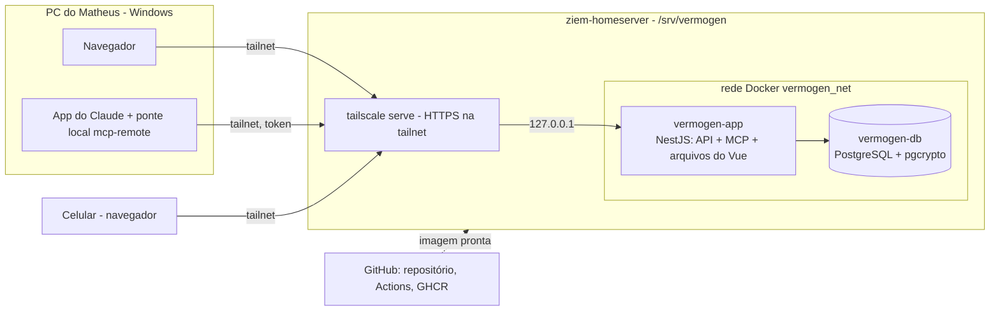

# SAD — Vermögen

> Software Architecture Document. Registra as decisões técnicas a partir da DT-04 (PRD §9.12). As DT-01 a DT-03 ficam no PRD §9.5.

| Campo | Valor |
|---|---|
| Versão | **1.3** |
| Status | **Aprovado pelo Matheus em 14/11/2026** |
| Dono | Chat de Arquitetura e Desenvolvimento (PRD §9.12). Os demais chats não editam este arquivo: registram propostas em `docs/propostas/` (§8) |
| Base | PRD v1.1 (`docs/PRD.md`) e protótipos (`docs/prototipos/`) |

### Histórico

| Versão | Data | Mudança |
|---|---|---|
| 1.0 | 14/11/2026 | Primeira versão: DT-04 a DT-22, contrato entre as frentes, sequência do MVP |
| 1.1 | 14/11/2026 | Ajustes vindos do esqueleto (HU-01). Contrato (§6): Node 24.15 ou superior; scripts `typecheck` e `test`; arquivos que a imagem precisa conter. Decisões menores DM-04 a DM-07. DT-16 e DT-18: dono e permissão dos segredos (proposta do DevOps, aceita). Impacto: nenhum em HU, prazo ou métricas |
| 1.2 | 15/11/2026 | Marco de 30/11 (v0.2.0). Contrato (§6): MCP em `/mcp` e comandos de token e de configuração inicial. DT-13: `listar_contas` antecipada. Decisões menores DM-09 a DM-17, incluindo a premissa da DM-12 (compra no dia do fechamento). Impacto: nenhum em HU, prazo ou métricas |
| 1.3 | 15/11/2026 | Marco de 14/12 (v0.3.0): 10 das 11 ferramentas da DT-13 (falta só `consultar_projecao`, de 29/12); decisões menores DM-18 a DM-24; pendência PD-3 (criar categoria pelo MCP). Impacto: nenhum em HU, prazo ou métricas |

### Como ler

- Cada decisão tem um identificador (DT-nn), a decisão, uma explicação em linguagem simples e o motivo. Toda DT pode ser revista (PRD §5).
- O §6 (contrato entre as frentes) é a parte que o chat DevOps precisa seguir à risca.
- Escolhas pequenas e reversíveis ficam no §10 (decisões menores), sem aprovação prévia.

---

## 1. Visão geral



- **Dois containers:** o app (API, MCP e telas no mesmo processo) e o banco.
- **Uma entrada:** o app publica só em `127.0.0.1`; quem está na tailnet chega pelo `tailscale serve`.
- **Build fora do servidor:** o GitHub monta a imagem; o servidor só baixa (DT-03).

---

## 2. Estrutura e código

### DT-04 — Monorepo com npm workspaces

**Decisão.** Um repositório só, com uma pasta por frente:

```
vermogen/
├── apps/
│   ├── api/                 NestJS: API, MCP, migrações
│   └── web/                 Vue 3
├── deploy/                  Dockerfile, compose, scripts de servidor
├── .github/workflows/       pipeline
├── docs/
│   ├── PRD.md
│   ├── SAD.md
│   ├── prototipos/
│   ├── propostas/
│   └── operacao/            roteiros de implantação e operação
├── package.json             workspaces e scripts da raiz
└── .env.example
```

**Em linguagem simples.** Tudo num lugar; cada frente trabalha nas suas pastas (DT-20).

**Por quê.** Um PR mostra a mudança inteira, e a separação por pasta evita conflito entre Dev e DevOps.

### DT-05 — Uma imagem só

**Decisão.** O NestJS serve a API (`/api`), o MCP (`/mcp`) e os arquivos estáticos do Vue (`/`). Não há container de nginx.

**Em linguagem simples.** Um pacote, dois containers (app e banco).

**Por quê.** Uma tag, uma porta e um healthcheck; sem CORS, porque tela e API têm a mesma origem. Cumpre a DT-01 (o Vue continua sendo só arquivos prontos). Muda a linha "nginx" da tabela de memória do PRD §9.5 (§11).

### DT-06 — Módulos por assunto e regras puras

**Decisão.**

| Módulo | Responsabilidade | Entrega |
|---|---|---|
| `config`, `database`, `health` | Variáveis e segredos, conexão, migrações, healthcheck | 16/11 |
| `auth` | Login, sessões, tokens do MCP, bloqueio global 401 | 16/11 |
| `auditoria` | Log, desfazer, lixeira | 30/11 |
| `cadastros` | Instituições, contas, finalidade com vigência, cartões | 30/11 |
| `calendario` | Feriados, dias úteis, ciclos (RN-01 a RN-04, RN-09) | 30/11 |
| `faturas` | Compra → fatura → ciclo; estados (RN-08) | 30/11 |
| `mcp` | Ferramentas; só traduz chamadas para os serviços dos outros módulos | "ping" em 30/11; completo em 14/12 |
| `transacoes` | Lançamento manual, parcelamentos, exclusão lógica | 14/12 |
| `importacao` | Lotes: conferência, repetição, desfazer | 14/12 |
| `classificacao` | Categorias, regras, pendências | 14/12 |
| `projecao` | Cálculo dos 12 ciclos, orçamento, metas, snapshot | 29/12 |
| `abertura` | Etapas 1, 2, 4 e 5; distribuição; congelar | 29/12 |

Fase 2: `compromissos`, `simulador`, `reserva`.

Regras:

1. **Regras de negócio são funções puras.** Ciclo, fatura e projeção recebem dados e devolvem resultado, sem banco e sem NestJS.
2. **Tela e MCP chamam os mesmos serviços.** O que muda é o autor (`matheus`, `claude` ou `sistema`).
3. **Nomes:** termos de domínio em português sem acento, como no glossário do PRD (`transacao`, `fatura`, `ciclo`); termos técnicos em inglês (`controller`, `service`).

**Em linguagem simples.** Cada regra existe num lugar só, e esse lugar pode ser testado sozinho.

**Por quê.** Os testes de borda do QA-07 rodam em milissegundos; nenhuma regra fica duplicada entre tela e MCP (DT-02).

### DT-07 — TypeORM com migrações escritas à mão

**Decisão.** Acesso ao banco com TypeORM. A criação automática de tabelas (`synchronize`) fica desligada. Toda mudança de esquema é um arquivo de migração numerado, em `apps/api/src/database/migrations/`.

**Em linguagem simples.** O banco só muda por arquivos que passam pela revisão.

**Por quê.** É o padrão do NestJS; as funções do pgcrypto exigem SQL explícito de qualquer forma.

### DT-14 — Frontend

**Decisão.** Vue 3, Vite, TypeScript, Pinia e Vue Router. CSS próprio, com as variáveis de cor dos protótipos; sem biblioteca de componentes.

**Em linguagem simples.** O visual vem direto dos protótipos aprovados.

**Por quê.** As regras DS-01 a DS-10 são específicas (barras retas, "i" com atraso de 1,5 s, cor por instituição); uma biblioteca pronta exigiria desfazer o estilo dela.

---

## 3. Banco de dados

### DT-08 — Esquema

Segue o modelo conceitual do PRD §9.4. Uma tabela só é criada na entrega que a usa.

| Tabela | Guarda | Observações |
|---|---|---|
| `usuario` | O único usuário | Senha com `crypt()` + `gen_salt('bf')` |
| `sessao` | Sessões do navegador | Hash do identificador, dispositivo, validade de 30 dias |
| `token_mcp` | Tokens do Claude | Hash com `crypt()`, nome, validade, revogação, último uso |
| `instituicao` | Bancos e emissores | Nome, cor (DS-06), ativo |
| `conta` | Contas e cartões | Tipo; cartão tem dia de fechamento e de vencimento |
| `conta_finalidade` | Finalidade com vigência | `vigente_de`, `vigente_ate` (RN-14) |
| `feriado` | Feriados bancários nacionais | RN-02 |
| `ciclo` | Mês financeiro | Id `2026-11`, início, fim, data esperada e data real do salário (RN-04) |
| `fatura` | Faturas de cartão | Fechamento, vencimento, valor, valor pago, status (modelo M3) |
| `transacao` | Todo movimento | Data da compra, data do pagamento, valor, descrições, categoria, fatura, parcela, origem, lote, chave de duplicata, situação de duplicata, `deleted_at` |
| `parcelamento` | A compra "mãe" | Valor total, N parcelas, data da compra |
| `importacao` | Lotes | Fonte, conta, período, total declarado, hash, contagens, status (modelo M2) |
| `categoria` | Árvore de categorias | Categoria-pai, natureza |
| `regra_categorizacao` | Classificação automática | Texto, conta, faixa de valor, prioridade → categoria |
| `meta` | Aporte, reserva, limite, folga | Tipo, valor, vigência; mudar cria nova versão |
| `orcamento` | Valor por categoria e ciclo | Vigência |
| `snapshot_projecao` | Projeção congelada | Detalhe em `jsonb`; data real do congelamento (M-03); marca "incompleto" |
| `auditoria` | Toda alteração | DT-09 |

Fase 2 ou 3: `compromisso`, `realizacao`, `distribuicao_aporte`, `conexao_open_finance`.

Regras de modelagem:

1. **Identificadores:** `uuid`, exceto `ciclo` (`2026-11`).
2. **Dinheiro:** `numeric(12,2)` no banco; centavos inteiros no código. Nunca ponto flutuante.
3. **Datas:** compra e pagamento são `date` (sem hora); registros de sistema são `timestamptz`. Fuso: `America/Sao_Paulo`.
4. **O ciclo da transação não é guardado.** É calculado pela data do pagamento, para a RN-04 redistribuir sem migrar dados (PRD §9.4).
5. **Pendência não é tabela.** É uma consulta: transação sem categoria, transação marcada como possível duplicata, lote não conferido.
6. **Receita fora das contas (D3):** transação sem conta, marcada como tal e vinculada à transação que ela compensa.
7. **Exclusão é sempre lógica** (`deleted_at`).
8. **Campos criptografados com `pgp_sym_encrypt`:** anotações e justificativas (PRD §9.4). A chave vem do segredo `pgcrypto_key` (DT-18) e nunca aparece em log.

### DT-09 — Auditoria por gatilho no banco, com autor obrigatório

**Decisão.** Um gatilho em cada tabela de dados grava em `auditoria` o antes e o depois de toda alteração. O app informa o autor (`matheus`, `claude` ou `sistema`) no início de cada transação de banco; sem autor, o banco recusa a gravação. Desfazer é reaplicar o "antes", e também fica registrado.

**Em linguagem simples.** Quem registra as alterações é o próprio banco, e ele não aceita mudança anônima.

**Por quê.** O QA-06 pede 100% das alterações no log. Com o gatilho, isso não depende de cada tela ou ferramenta lembrar de registrar.

### DT-10 — Lote: formato único e três verificações

**Decisão.** Tela, MCP e, no futuro, Open Finance entregam o mesmo formato de lote: conta, período, itens e, quando houver, total declarado ou saldos inicial e final.

| Verificação | Regra | Resultado |
|---|---|---|
| Conferência (QA-04) | Soma dos itens = total declarado. Sem total: saldo inicial + movimentos = saldo final. Sem nenhum dos dois: não conferido | Com diferença, o lote é rejeitado e nada é gravado |
| Repetição (QA-05) | Hash calculado **pelo app** sobre o conteúdo do lote. Mesma conta + mesmo período + mesmo total de um lote já aceito também conta como repetido | 0 transações novas |
| Duplicatas (D2) | Transação com a mesma chave (conta, data, valor, descrição, parcela) de outra já existente, do mesmo lote ou de outro | Entra marcada como "possível duplicata"; nunca é descartada sozinha |

Limite: 500 itens por lote.

**Em linguagem simples.** O app confere a soma, recusa o que já recebeu e pede revisão do que parece repetido.

**Por quê.** O hash é do conteúdo, e não do arquivo, porque o Claude não calcula o hash de um PDF com confiança. A segunda regra de repetição cobre o caso de o Claude reler o mesmo documento com pequenas diferenças de texto.

---

## 4. Acesso e MCP

### DT-11 — Autenticação

**Decisão.**

| Item | Regra |
|---|---|
| App web | Cookie de sessão de 30 dias por dispositivo (`HttpOnly`, `Secure`, `SameSite=Strict`). Limite de 5 tentativas de login a cada 15 min |
| MCP | Token no cabeçalho `Authorization: Bearer`, formato `vmg_<id>_<segredo>`. **Validade de 6 meses**, revogável a qualquer momento |
| Criação de senha e token | Por comando no servidor; o valor aparece uma vez e não é gravado em arquivo |
| Rotas públicas | Arquivos estáticos da tela, `POST /api/auth/login` e `GET /api/health`. Todo o resto responde 401 sem credencial |

**Leitura do CA1 da HU-01 (confirmada pelo Matheus).** "Toda rota responde 401" vale para toda rota de dados. O health responde só `ok` e a versão.

**Em linguagem simples.** Você entra uma vez por dispositivo; o Claude usa uma chave própria que vence em 6 meses.

**Por quê.** QA-02. A validade limita o dano de um token esquecido no PC.

### DT-12 — MCP por HTTP, com ponte local no PC

**Decisão.** O módulo `mcp` atende em `/mcp` (transporte HTTP do protocolo). No Windows, o app do Claude usa um conector local (`mcp-remote`) que repassa as chamadas ao homeserver pela tailnet, com o token.

**Em linguagem simples.** O Claude do PC fala com um "tradutor" local, e esse tradutor fala com o servidor.

**Por quê.** Os conectores remotos do app do Claude partem da nuvem da Anthropic e não alcançam a tailnet. **Premissa a validar em 30/11** com a ferramenta `ping` (§9, PV-1).

### DT-13 — Ferramentas do MCP no MVP

| Ferramenta | Tipo | Faz |
|---|---|---|
| `ping` | Leitura | Confirma conexão, token e versão (validação da DT-12) |
| `listar_contas` | Leitura | Contas com instituição, tipo e finalidade vigente (antecipada para 30/11: os cadastros já existem) |
| `listar_categorias` | Leitura | Árvore de categorias |
| `listar_lotes` | Leitura | Lotes por ciclo, conta e status |
| `consultar_transacoes` | Leitura | Busca com filtros e paginação |
| `listar_pendencias` | Leitura | Sem categoria, possível duplicata, lote não conferido |
| `consultar_projecao` | Leitura | 12 ciclos (entra em 29/12; as demais ferramentas desta tabela estão na v0.3.0) |
| `importar_lote` | Escrita | Lote no formato da DT-10; item pode trazer categoria |
| `desfazer_lote` | Escrita | Desfaz o lote inteiro (HU-09) |
| `resolver_pendencia` | Escrita | Categorizar; confirmar ou negar duplicata; aceitar ou descartar lote não conferido |
| `registrar_lancamento` | Escrita | Lançamento manual, incluindo receita fora das contas (necessário para a migração, D3) |

Regras:

1. Sem SQL livre (PRD §3.3).
2. Toda escrita entra com autor `claude` e passa pela auditoria (DT-09).
3. Não existe ferramenta para alterar valor ou data de transação: erro de leitura se corrige desfazendo o lote (PRD §3.3).
4. Mensagens de erro dizem o que corrigir (ex.: a diferença entre a soma e o total).
5. As demais escritas (regras, metas, compromissos, reserva) são da Fase 2.

---

## 5. Implantação e entrega da imagem

### DT-15 — Build no GitHub Actions, imagem no GHCR

**Decisão.**

| Momento | O que o pipeline faz |
|---|---|
| Todo PR | Verificação de tipos, testes (com PostgreSQL de teste) e build |
| Tag `vX.Y.Z` no `main` | Constrói a imagem (`linux/amd64`) e publica em `ghcr.io/mh-ziem/vermogen:X.Y.Z` e `:sha-<7>` |

O pacote no GHCR é **privado**, mesmo que o repositório seja público. O servidor faz `docker login ghcr.io` uma única vez, com um token só de leitura de pacotes.

**Em linguagem simples.** O pacote é montado nos servidores do GitHub; o homeserver só baixa.

**Por quê.** Cumpre a DT-03 sem depender do PC do Matheus. Nunca se usa `latest` (convenção do servidor).

### DT-16 — Implantação no homeserver

**Decisão.**

```
/srv/vermogen/
├── compose.yml      cópia de deploy/compose.yml
├── .env             versão da imagem e porta (sem segredos)
├── secrets/         pasta do root (0700); dono e permissão de cada arquivo na DT-18
└── backups/         dumps feitos antes de migração
```

| Item | Valor |
|---|---|
| Containers | `vermogen-app` e `vermogen-db` |
| Banco | PostgreSQL 17 (versão menor fixada pelo DevOps), sem porta publicada |
| Rede e volume | `vermogen_net` e `vermogen_pgdata`, próprios |
| Limites | 512 MB por container (soma de 1 GiB; QA-12 permite até 4 GiB); CPU definida pelo DevOps |
| Reinício | `restart: unless-stopped` com healthcheck nos dois |
| Arquivos de `deploy/` | Chegam ao servidor por `scp`, a partir do clone do Matheus |
| Registro | Linha em `/srv/REGISTRY.md` |

A porta é escolhida depois de consultar `/srv/REGISTRY.md`.

### DT-16b — Exposição por `tailscale serve`

**Decisão.** O app publica só em `127.0.0.1:<porta>`. O `tailscale serve` expõe essa porta na tailnet, com HTTPS.

**Em linguagem simples.** O Tailscale faz a ponte entre a tailnet e a porta local.

**Por quê.** Publicar direto no IP da tailnet pode falhar no boot, se o Docker subir antes do Tailscale (risco ao QA-08). O HTTPS permite cookie `Secure`. Efeito colateral aceito: o nome da máquina na tailnet aparece num registro público de certificados.

### DT-17 — Migrações na subida do app

**Decisão.** Ao iniciar, o app espera o banco, aplica as migrações pendentes e só então abre a porta. Se uma migração falhar, o app encerra com o erro no log. Toda entrega que contém migração avisa isso no PR, e o roteiro de atualização faz um `pg_dump` antes, guardando os últimos 5 em `/srv/vermogen/backups/`.

**Em linguagem simples.** Atualizar é sempre "baixar e subir"; o dump é a rede de segurança.

**Por quê.** O servidor não tem backup (R5 é Fase 3). Voltar atrás é a tag anterior mais o dump.

### DT-18 — Segredos

**Decisão.** Dois segredos, como arquivos em `/srv/vermogen/secrets/`, montados pelo Compose em `/run/secrets/`:

| Segredo | Uso | Dono (uid:gid) | Permissão | Quem lê |
|---|---|---|---|---|
| `db_password` | Senha do PostgreSQL | `999:1000` | `0440` | Banco (uid 999 na imagem oficial) e app (uid 1000) |
| `pgcrypto_key` | Chave do `pgp_sym_encrypt` | `1000:1000` | `0400` | Só o app; o banco nem recebe o arquivo |

Fora do Swarm, o Compose monta o arquivo com o mesmo dono e a mesma permissão do servidor; por isso o dono é definido no próprio arquivo (proposta `2026-11-14-devops-permissao-segredos`, aceita).

Os arquivos são criados pelo Matheus no servidor, com os comandos do roteiro `docs/operacao/primeira-implantacao.md` (passo 4). Não entram no repositório nem na imagem (QA-03). Senha de login e token do MCP não são segredos de arquivo: ficam no banco, como hash (DT-11).

**Atenção:** perder a `pgcrypto_key` torna ilegíveis as anotações e justificativas. O roteiro de primeira implantação orienta guardar uma cópia fora do servidor.

---

## 6. Contrato entre as frentes (DT-19)

Vale para Dev e DevOps. Só muda por proposta (§8).

| Item | Valor |
|---|---|
| Imagem | `ghcr.io/mh-ziem/vermogen`; tags `X.Y.Z` e `sha-<7>`; nunca `latest` |
| Node | 24 LTS, versão 24.15 ou superior (exigência das ferramentas de build do NestJS 12) |
| Build | Na raiz: `npm ci` e `npm run build` |
| Verificação | Na raiz: `npm run typecheck` e `npm test`. Os testes de integração usam um PostgreSQL 17 e leem as variáveis abaixo |
| Conteúdo da imagem | `apps/api/dist/`, `apps/api/package.json` (declara o formato dos módulos e a versão), `apps/web/dist/` e as dependências de produção, na mesma árvore do repositório |
| Início | `node apps/api/dist/main.js` |
| Porta interna | `3000` |
| Usuário | Não-root, uid 1000 |
| Estado | O app não tem volume; todo dado fica no banco |
| Log | Em stdout |
| Encerramento | Atende `SIGTERM` e encerra em até 10 s |
| Banco | O app espera o banco com novas tentativas; não depende da ordem de subida |
| Migrações | Automáticas na subida (DT-17) |
| Healthcheck | `GET /api/health` → `200 {"status":"ok","versao":"X.Y.Z"}` quando banco e migrações estão ok; `503` caso contrário |

**Variáveis de ambiente**

| Variável | Exemplo | Para quê |
|---|---|---|
| `PORT` | `3000` | Porta interna |
| `TZ` | `America/Sao_Paulo` | Fuso |
| `DB_HOST` | `vermogen-db` | Endereço do banco |
| `DB_PORT` | `5432` | Porta do banco |
| `DB_NAME` | `vermogen` | Nome do banco |
| `DB_USER` | `vermogen` | Usuário do banco |
| `DB_PASSWORD_FILE` | `/run/secrets/db_password` | Caminho do segredo |
| `PGCRYPTO_KEY_FILE` | `/run/secrets/pgcrypto_key` | Caminho do segredo |
| `PUBLIC_URL` | `https://<nome>.<tailnet>.ts.net` | Endereço pelo qual o app é acessado |
| `LOG_LEVEL` | `info` | Nível de log |

**Comandos de operação** (dentro do container `vermogen-app`)

| Comando | Faz |
|---|---|
| `node apps/api/dist/cli.js definir-senha` | Cria ou troca a senha de login |
| `node apps/api/dist/cli.js criar-token-mcp --nome <nome>` | Cria um token do MCP, válido por 6 meses. O token sai sozinho no stdout (uma linha começando com `vmg_`); as mensagens saem no stderr |
| `node apps/api/dist/cli.js revogar-token-mcp <id>` | Revoga um token |
| `node apps/api/dist/cli.js listar-tokens-mcp` | Lista id, situação, validade, último uso e nome |
| `node apps/api/dist/cli.js cadastrar-configuracao-inicial` | Cadastra as 5 instituições e 9 contas do PRD §9.4; só roda com o cadastro vazio |

**MCP** (a partir da 0.2.0)

| Item | Valor |
|---|---|
| Endereço | `POST /mcp`, transporte Streamable HTTP, sem sessão; respostas em JSON. `GET` e `DELETE` → 405 |
| Credencial | Só `Authorization: Bearer vmg_<id>_<segredo>`. Sem token válido: 401 com `WWW-Authenticate: Bearer realm="vermogen"`. O cookie da tela não vale no MCP, e o token não vale em `/api` |
| Ferramentas | As da DT-13 já disponíveis na versão; `ping` devolve `{"status":"ok","versao":"X.Y.Z"}` |

---

## 7. Desenvolvimento em paralelo

### DT-20 — Fronteira no repositório e fluxo de git

| Pasta | Dono |
|---|---|
| `apps/`, `package.json` e `package-lock.json` da raiz, `.env.example`, `docs/PRD.md`, `docs/SAD.md`, `docs/prototipos/` | Dev (chat de Arquitetura e Desenvolvimento) |
| `deploy/`, `.github/workflows/`, `docs/operacao/` | DevOps |
| `docs/propostas/` | Qualquer chat cria; só o chat Dev responde |

Fluxo:

1. Branches curtas: `dev/<assunto>` e `ops/<assunto>`.
2. Nenhum chat grava no `main`. Os chats fazem commit e push na própria branch, abrem o PR e informam o Matheus.
3. Um PR por entrega. O Matheus revisa e faz o merge (squash): esse é o commit dele no `main`.
4. Cada chat usa uma pasta de trabalho própria (git worktree), para dois chats não mexerem na mesma pasta ao mesmo tempo. Dev: `~/codes/Vermogen`. DevOps: `~/codes/Vermogen-ops`.
5. Quem precisa de mudança na pasta do outro abre proposta (§8); não edita.

### DT-21 — Sequência e pontos de sincronização

| Marco | Dev | DevOps | Sincronização (o Matheus implanta) |
|---|---|---|---|
| **16/11** | Esqueleto: monorepo, health, login (HU-01), tela de login | Dockerfile, pipeline, compose, roteiro da primeira implantação (HU-02) | `v0.1.0`: 401 sem credencial, scan a partir da LAN, teste de reboot |
| **30/11** | HU-03 a HU-07; `ping` do MCP | Roteiro de atualização com dump; conexão do Claude no Windows; medição de memória | `v0.2.0`: valida a DT-12 |
| **14/12** | HU-08 a HU-14 | Roteiro do token do MCP; ajustes de operação | `v0.3.0`; em seguida, migração da planilha via MCP |
| **29/12** | HU-15 a HU-17 | Verificação final de QA-01, QA-08 e QA-12 | `v1.0.0`; primeira abertura real em 30/12 |

Regras:

1. Uma implantação planejada por marco. Fora do marco, só correção de defeito que bloqueia o uso.
2. As datas são metas flexíveis (PRD §2.1). O MVP não cresce para compensar atraso (PRD §9.9).
3. Ordem dentro do marco de 16/11: o Dev entrega o esqueleto primeiro, porque o Dockerfile depende dele; o DevOps parte do contrato (§6) e pode preparar compose e roteiro em paralelo.

### DT-22 — Propostas e carga de revisão

Formato e resposta das propostas: §8.

Carga de revisão (R3):

1. O Matheus só revisa PR com o pipeline verde; os testes cobrem os critérios de aceite da HU.
2. Todo PR traz: resumo em linguagem simples; lista de CA com a evidência; os arquivos que merecem leitura; roteiro de verificação de até 5 minutos; aviso "contém migração: sim/não".
3. Toda implantação vem com os comandos prontos em bloco de código (R6) e um roteiro curto de verificação (V-03).
4. Decisões que dependem do Matheus chegam em lote, com recomendação.
5. Escolhas pequenas e reversíveis são tomadas pelo chat e registradas no §10.
6. PRs de Dev e de DevOps não tocam as mesmas pastas e podem ser revisados em qualquer ordem.

---

## 8. Propostas de mudança

**Arquivo:** `docs/propostas/AAAA-MM-DD-<chat>-<assunto>.md` (ex.: `2026-11-20-devops-limite-cpu.md`).

**Modelo:**

```markdown
# Proposta: <título>

| Campo | Valor |
|---|---|
| Origem | <chat> |
| Data | AAAA-MM-DD |
| Status | aberta |
| Urgência | <bloqueia o quê, até quando> ou "não bloqueia" |

## O que muda
## Por quê
## Impacto
(HU, prazo, métricas, contrato do SAD §6)
## Alternativa se recusada

## Resposta
(preenchida pelo chat de Arquitetura e Desenvolvimento)
```

**Como é respondida:**

1. O Matheus avisa o chat Dev de que há proposta nova. O chat Dev também confere a pasta no início de cada entrega.
2. O chat Dev preenche "Resposta" com o status (`aceita`, `aceita com ajustes`, `recusada` ou `adiada`), o motivo e a DT alterada.
3. A mudança no SAD ou no PRD vai no mesmo PR da resposta. O merge do Matheus é a aprovação.
4. Proposta que bloqueia uma frente é respondida antes de qualquer outra entrega.

---

## 9. Premissas a validar e pendências

| ID | Item | Quando | Se falhar |
|---|---|---|---|
| PV-1 | O app do Claude no Windows alcança o MCP pela ponte local (DT-12) | 30/11, com `ping` | Rever o transporte do MCP antes de construir a importação |
| PV-2 | `tailscale serve` com HTTPS funciona na tailnet e volta sozinho após reboot (DT-16b) | Primeira implantação | Publicar no IP da tailnet, com ordem de subida no systemd |
| PV-3 | Uma chamada `importar_lote` com ~300 itens cabe numa resposta do Claude (DT-10) | 14/12 | Permitir enviar o lote em partes, com conferência no fechamento |
| PD-1 | O repositório no GitHub está **público**, e o PRD traz dados pessoais (renda, reserva, empregador) | Decisão do Matheus | — |
| PD-2 | Ajustes no PRD decorrentes deste SAD (§11) | Próxima versão do PRD | — |
| PD-3 | A migração da planilha (HU-11) precisa das categorias dela. Hoje só a tela cria categorias; o Claude pode criar regras ao resolver pendências, mas não categorias. Proposta: ferramenta `criar_categoria` no MCP, registrada e reversível como as demais escritas | Antes da migração (depois da v0.3.0) | O Matheus cria as categorias pela tela antes da migração |

---

## 10. Decisões menores

Escolhas pequenas e reversíveis, tomadas pelo chat e registradas aqui (DT-22).

| ID | Data | Decisão | Motivo |
|---|---|---|---|
| DM-01 | 14/11/2026 | Gráficos em SVG próprio, sem biblioteca de gráficos | Os protótipos já são assim, e a DS-02 (barras retas) fica sob controle total |
| DM-02 | 14/11/2026 | Pasta dos protótipos em minúsculas: `docs/prototipos/` | Padrão dos demais caminhos |
| DM-03 | 14/11/2026 | Menu conforme o protótipo: Início, Abertura do ciclo, Projeção, Simulador de cenários, Transações, Contas, Metas, Configurações. No MVP, os itens de Fase 2 não aparecem | PRD §9.8 |
| DM-04 | 14/11/2026 | Módulos em formato ESM e testes com Vitest, na API e na tela | É o padrão do NestJS 12 e do Vue atuais; seguir o padrão reduz manutenção |
| DM-05 | 14/11/2026 | O login pede só a senha; o usuário é fixo (`matheus`) | O app tem um único usuário (PRD §3.4). Senha com mínimo de 12 caracteres |
| DM-06 | 14/11/2026 | A autenticação tem duas barreiras: uma antes do roteador (até rota inexistente responde 401) e uma em cada rota | HU-01 CA1; uma rota nova nasce protegida sem depender de alguém lembrar |
| DM-07 | 14/11/2026 | Arquivos de migração nomeados pelo instante de criação (`<milissegundos>-<assunto>.ts`) | Exigência do TypeORM; é o que define a ordem de aplicação |
| DM-08 | 14/11/2026 | A versão da tag (`vX.Y.Z`) precisa ser igual ao `version` de `apps/api/package.json`; o pipeline recusa a publicação se não for | O health mostra a versão do `package.json`; sem a conferência, a imagem `0.2.0` poderia dizer `0.1.0` |
| DM-09 | 15/11/2026 | Feriados bancários calculados por regra (datas fixas + Páscoa para carnaval, Sexta-feira Santa e Corpus Christi; 31/12 sem expediente; Consciência Negra a partir de 2024). A tabela `feriado` da DT-08 só será criada se surgir exceção | Nenhum cadastro a manter todo ano; a regra é testada (QA-07) |
| DM-10 | 15/11/2026 | MCP com a biblioteca oficial `@modelcontextprotocol/sdk` 1.32, e não com `@nestjs/mcp` | O pacote do Nest está na versão 0.0.4, publicado há poucos dias |
| DM-11 | 15/11/2026 | Acesso ao banco por SQL explícito e parametrizado; o TypeORM fica só com a conexão e as migrações, sem entidades | As regras usam funções do PostgreSQL (pgcrypto, intervalos, restrições de vigência) que o SQL mostra direto na revisão |
| DM-12 | 15/11/2026 | **Premissa:** compra feita no próprio dia do fechamento entra na fatura seguinte | É a prática comum dos cartões ("melhor dia de compra"). Conferir com a primeira fatura real de cada cartão; se algum banco fizer diferente, vira configuração do cartão |
| DM-13 | 15/11/2026 | A primeira finalidade de uma conta cadastrada sem data vale para todo o histórico (guardada como 2000-01-01, exibida como "desde o início") | A migração da planilha traz transações desde jul/2025, e todas precisam de finalidade (RN-14) |
| DM-14 | 15/11/2026 | A tabela `ciclo` guarda só os ciclos com data real do salário; os demais são calculados. A tabela `fatura` fica para a entrega das transações (14/12) | Uma tabela só é criada na entrega que a usa (DT-08); o ciclo calculado não precisa de linha |
| DM-15 | 15/11/2026 | Hash do token do MCP com `crypt()` de custo 8 (a senha usa 12) | O segredo tem 256 bits sorteados, então o custo não muda a segurança; com custo 12, cada chamada do Claude gastaria cerca de 1 s de CPU no servidor |
| DM-16 | 15/11/2026 | A auditoria cobre as tabelas de dados. As de acesso (`usuario`, `sessao`, `token_mcp`) ficam fora | Login e uso do token gerariam um registro por acesso, sem valor para o QA-06 |
| DM-17 | 15/11/2026 | A data real do salário precisa estar a até 15 dias da esperada e não pode inverter a ordem dos ciclos | Evita erro de digitação que reorganizaria o histórico inteiro (RN-04) |
| DM-18 | 15/11/2026 | Valor e datas de uma transação não mudam depois de gravados, nem pela tela: corrige-se desfazendo o lote ou excluindo e lançando de novo | Mesma regra do Claude (PRD §3.3), aplicada a todos: o documento é a fonte da verdade e o log fica simples |
| DM-19 | 15/11/2026 | Lote rejeitado (soma não confere) não é gravado; o erro volta para quem enviou, com a diferença | HU-08 CA1 ("nada gravado"); o Claude relê e reenvia na mesma conversa |
| DM-20 | 15/11/2026 | Lote de cartão leva a fatura do documento (fechamento e vencimento) e todas as compras, inclusive parcelas antigas, entram nela. Sem a fatura, cada item vai para a fatura calculada pela sua data | A parcela 3/4 de uma compra de agosto é paga na fatura de novembro; a data da compra não diz isso |
| DM-21 | 15/11/2026 | Categoria enviada pelo Claude no item vale mais que a regra; sem categoria, vale a regra; sem regra, fica pendente | O Claude lê o documento inteiro; a regra cobre o que ele não classificou |
| DM-22 | 15/11/2026 | Transferência e pagamento de fatura não pedem categoria nem aparecem como pendência "sem categoria" | Movem dinheiro entre contas próprias; categorizar contaria o gasto duas vezes |
| DM-23 | 15/11/2026 | A entidade Parcelamento e as parcelas futuras ficam para a entrega da projeção (29/12); por ora a parcela (n/N) fica na própria transação | Só a projeção usa as parcelas futuras (RN-11); a migração precisa só das parcelas já pagas |
| DM-24 | 15/11/2026 | Comandos `UPDATE`/`DELETE … RETURNING` passam pela função `alterar()` | O TypeORM devolve `[linhas, quantidade]` nesses comandos; o engano causou dois defeitos na 0.2.0, já corrigidos |

---

## 11. Ajustes pendentes no PRD

Entram numa próxima versão do PRD, pelo processo do §9.12. Nenhum altera HU, prazo ou métricas.

| Onde | Ajuste |
|---|---|
| §9.5, tabela de memória | "Vue (arquivos estáticos servidos por nginx)" → servidos pelo próprio NestJS (DT-05) |
| §9.5, QA-02 | Token do MCP com validade de 6 meses (DT-11) |
| §9.8 | Pasta `Prototipos/` → `docs/prototipos/` |
| §9.4, Importação | "hash do documento" → hash do conteúdo do lote, calculado pelo app (DT-10) |
| §9.10, HU-01 CA1 | Registrar as três rotas públicas (DT-11) |
| §9.2, RN-08 | Registrar a premissa da DM-12: compra no dia do fechamento entra na fatura seguinte |
